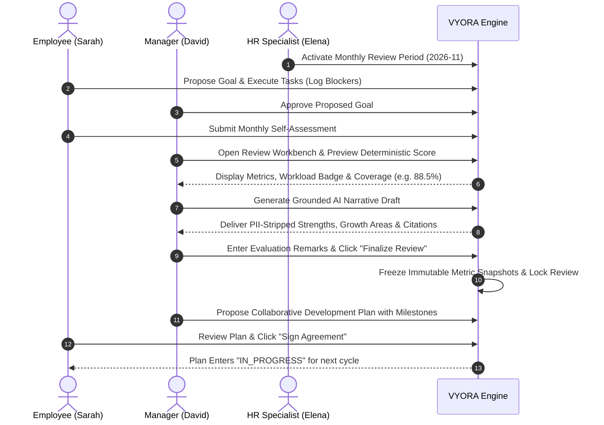

# VYORA — Role-Based Access Control & User Operations Guide
**Smart Performance Management & Employee Development Intelligence Platform**

---

## 1. Executive Role Capability Matrix

VYORA enforces strict, non-negotiable role-based boundaries across four system personas:

| Capability / Operation | EMPLOYEE | MANAGER | HR SPECIALIST | SYSTEM ADMIN |
| :--- | :---: | :---: | :---: | :---: |
| **View Personal Goals, Tasks & Metrics** | Full Access | Self + Direct Reports | All Roster | All System |
| **Propose Personal Goals** | Yes (`PENDING_APPROVAL`) | Yes (Direct Active) | Yes (Direct Active) | Yes (Direct Active) |
| **Approve / Reject Subordinate Goals** | Forbidden | Direct Reports Only | Org Override | Org Override |
| **Create & Advance Tasks** | Own Assigned Tasks | Team Tasks | Read-Only | Read-Only |
| **Log Task Blockers with Audit Reasons** | Yes | Yes | Read-Only | Read-Only |
| **Submit Monthly Self-Assessment** | Yes | Yes (to their manager) | Optional | Optional |
| **Submit Manager Review Feedback** | Forbidden | Direct Reports Only | Read-Only | Read-Only |
| **Preview Deterministic Scoring Breakdown** | Self Only | Direct Reports + Self | Org Analytics | Org Analytics |
| **Generate Grounded AI Narrative Insight** | View Self Insight | Trigger for Reports | View Summary | System View |
| **Flag Inaccurate AI Insight Discrepancy** | Yes (Reports to Mgr) | Review Flags | View Flags | Audit Trail |
| **Finalize Review & Freeze Snapshots** | Forbidden | Direct Reports Only | Audit Only | Audit Only |
| **Collaborative Development Plans** | Digital Sign Agreement | Create & Propose | Org Overview | Org Overview |
| **Toggle Development Plan Milestones** | Yes (Own Milestones) | Yes (Report Milestones) | Read-Only | Read-Only |
| **Organization Structure & Department CRUD** | Forbidden | Forbidden | Full Access | Full Access |
| **Standard Role KPI Template Weighting** | Forbidden | Forbidden | Full Access (Must = 1.0) | Read-Only |
| **Bulk CSV Employee Ingestion with Ledger** | Forbidden | Forbidden | Full Access | Full Access |
| **User Account Provisioning & Roles** | Forbidden | Forbidden | Read Roster | Full Access |
| **Immutable Security & Operational Audit Log**| Forbidden | Forbidden | Read-Only | Full Access |

---

## 2. Role 1: EMPLOYEE (`EMPLOYEE`)

### 2.1 Persona Objective & Role Overview
The Employee is the central subject and active participant in the performance intelligence cycle. VYORA empowers employees by making evaluations explainable, workload-aware, and focused on growth rather than surveillance.

### 2.2 What the Employee Can View
1. **Personal Intelligence Dashboard (`/dashboard/employee`):**
   - Active review cycle countdown and status.
   - Goals in flight with percentage progress bars.
   - Monthly tasks completed vs open.
   - Workload context indicator badge (`NORMAL`, `HIGH_WORKLOAD`, `OVERLOADED`).
   - Deterministic performance score breakdown (with coverage audit indicator).
   - Current active collaborative development plan.
2. **Goals Tracker (`/dashboard/employee/goals`):**
   - All assigned and personal goals.
   - Target metrics, baseline values, target outcomes, and due dates.
   - Current approval status badge (`PENDING`, `APPROVED`, `REJECTED`).
3. **Tasks & Contextual Blockers (`/dashboard/employee/tasks`):**
   - Personal task Kanban/table with priority and complexity tags (`LOW`, `MEDIUM`, `HIGH`).
   - Active blocker notices explaining delays.
4. **Monthly Reviews & Snapshot History (`/dashboard/employee/reviews`):**
   - Past finalized reviews.
   - Manager evaluation remarks.
   - Immutable frozen evidence snapshots showing exactly which metric weights were applied.
5. **Growth & Development Hub (`/dashboard/employee/growth`):**
   - Bilateral development plans with agreed objectives.
   - Action item milestone checklist with target completion dates.

### 2.3 What the Employee Can Update & Perform
- **Propose Goals:** Submit new quantitative goals for review period approval.
- **Update Goal Progress:** Move the slider or input numeric progress values on approved active goals.
- **Advance Task Lifecycle:** Move tasks from `TODO` &rarr; `IN_PROGRESS` &rarr; `COMPLETED`.
- **Log Blockers:** Place a task in `BLOCKED` status by providing a mandatory description (e.g., dependency on external team, hardware failure).
- **Submit Self-Assessment:** Write qualitative self-evaluations detailing accomplishments, unexpected friction, and cross-team contributions.
- **Flag AI Discrepancies:** If an AI narrative makes an inaccurate claim, click **"Flag Discrepancy"** to notify the manager with supporting context.
- **Digital Plan Agreement:** Click **"Sign Agreement"** to transition a proposed development plan into active status.
- **Toggle Milestones:** Check off completed action item milestones on active growth plans.

### 2.4 Strict Prohibitions & Enforced Restrictions
- ❌ **Cannot Approve Goals:** Cannot approve their own proposed goals or colleagues' goals.
- ❌ **Cannot View Other Employees' Data:** Strictly blocked from seeing peers' scores, reviews, or tasks.
- ❌ **Cannot Finalize Reviews:** Cannot lock or finalize formal monthly reviews.
- ❌ **Cannot Alter KPI Weights:** Cannot modify standard organizational weighting or formulas.

---

## 3. Role 2: MANAGER / TEAM LEADER (`MANAGER`)

### 3.1 Persona Objective & Role Overview
The Manager acts as coach, evaluator, and capacity steward for their assigned team. They review objective evidence, inspect deterministic scores, provide qualitative guidance, and establish growth plans.

### 3.2 What the Manager Can View
1. **Team Leadership Overview (`/dashboard/manager`):**
   - Direct reports roster with individual workload capacity badges.
   - Count of pending goal approval requests.
   - Direct links to employee review workbenches.
2. **Review Workbench (`/dashboard/manager/reviews`):**
   - Comprehensive multi-step evaluation portal for any assigned report.
   - Real-time deterministic score calculations with data coverage percentages.
   - Qualitative self-assessment submitted by the employee.
   - Grounded AI narrative explanation with verified evidence citations.
   - Formal finalization controls.
3. **Goal Approval Queue (`/dashboard/manager/approvals`):**
   - Centralized queue of employee-proposed goals requiring review.
4. **Team Workload Heatmap (`/dashboard/manager/workload`):**
   - Team-wide breakdown of open tasks, blocked items, and high-complexity task distributions.

### 3.3 What the Manager Can Update & Perform
- **Approve or Reject Goals:** Approve or reject subordinate goals with immediate status updates.
- **Create & Assign Tasks:** Assign tasks to direct reports with specified priority (`LOW`..`URGENT`) and complexity (`LOW`, `MEDIUM`, `HIGH`).
- **Submit Manager Evaluation Feedback:** Add qualitative feedback and strength/growth observations.
- **Trigger AI Narrative Generation:** Request Gemini to synthesize objective evidence into a structured draft (with PII stripped).
- **Review Discrepancy Flags:** Inspect employee-submitted flags on AI insights before finalization.
- **Finalize Performance Reviews:** Provide formal review summary remarks and execute the finalization transaction, which locks the review and freezes immutable metric snapshots.
- **Create Collaborative Development Plans:** Draft structured growth plans with objectives and milestones for direct reports.
- **Toggle Action Items:** Check off completed development milestones in partnership with the employee.

### 3.4 Strict Prohibitions & Enforced Restrictions
- ❌ **Cannot Evaluate Unrelated Employees:** Attempting to review an employee not supervised by the manager raises a `403 Forbidden` / `AuthorizationError`.
- ❌ **Cannot Arbitrarily Overwrite Scores:** The deterministic score is calculated strictly by algorithms based on verified evidence; managers provide evaluation remarks and finalization, not ad-hoc score tampering.
- ❌ **Cannot Re-finalize Locked Reviews:** Once finalized, review snapshots are immutable. Attempting to modify them raises a `400 Bad Request`.
- ❌ **Cannot Modify Org Structure or KPI Templates:** Department hierarchies and role KPI configurations belong exclusively to HR.

---

## 4. Role 3: HUMAN RESOURCES (`HR`)

### 4.1 Persona Objective & Role Overview
The HR Specialist governs company-wide organizational structures, standardizes evaluation criteria across job roles, and oversees onboarding workflows.

### 4.2 What HR Can View
1. **Organization Analytics (`/dashboard/hr`):**
   - Company headcount and department distribution.
   - Review period completion progress across all teams.
2. **Employee Directory (`/dashboard/hr/directory`):**
   - Global employee roster, role titles, and department codes.
3. **Role KPI Templates Catalog (`/dashboard/hr/kpi-templates`):**
   - Standardized KPI weight distributions across all active job roles.

### 4.3 What HR Can Update & Perform
- **Manage Organization Hierarchy:** Create and update departments (`/organizations/departments`) and job roles (`/organizations/roles`).
- **Batch CSV Employee Ingestion:** Upload bulk employee files with an automated row-by-row error ledger that records import errors without aborting valid rows.
- **Configure Standard Role KPI Templates:** Define target weights and minimum evidence thresholds for each job role, enforcing the rule that all role weights must sum to exactly 1.00 (100%).
- **Schedule Review Periods:** Open, advance, or close company review periods (`UPCOMING` &rarr; `ACTIVE` &rarr; `EVALUATION` &rarr; `CLOSED`).

### 4.4 Strict Prohibitions & Enforced Restrictions
- ❌ **Cannot Tamper with Performance Scores:** HR cannot override frozen review snapshots or alter mathematical outcomes.
- ❌ **Cannot Bypass Mathematical Balance:** Cannot save role KPI templates whose weights do not sum to 100%.

---

## 5. Role 4: SYSTEM ADMINISTRATOR (`ADMIN`)

### 5.1 Persona Objective & Role Overview
The System Administrator oversees platform reliability, security controls, technical compliance, and user account provisioning.

### 5.2 What the Admin Can View
1. **System Health & Governance (`/dashboard/admin`):**
   - Live operational health status (`/api/v1/audit/health`).
   - Database connection telemetry and pool status.
   - AI sandboxing and PII anonymization status.
2. **Security Audit Trail (`/dashboard/admin/audit-logs`):**
   - Append-only audit ledger showing every state-changing action, timestamp, actor ID, resource type, and IP address.
3. **User Account Governance (`/dashboard/admin/users`):**
   - System-wide user list, active status, and security roles.

### 5.3 What the Admin Can Update & Perform
- **Provision & Deactivate Accounts:** Create user accounts, reset credentials, and assign system roles (`EMPLOYEE`, `MANAGER`, `HR`, `ADMIN`).
- **Inspect Security Incidents:** Search and filter immutable audit logs for compliance reviews.
- **Configure Technical Parameters:** Manage environment secrets, CORS origins, and system settings.

### 5.4 Strict Prohibitions & Enforced Restrictions
- ❌ **Cannot Erase Audit Logs:** Audit logs are strictly append-only in PostgreSQL. Deletion is prohibited by database design.

---

## 6. Standard Monthly Review Cycle Workflow

---
*End of Role-Based Access Control & User Operations Guide.*
