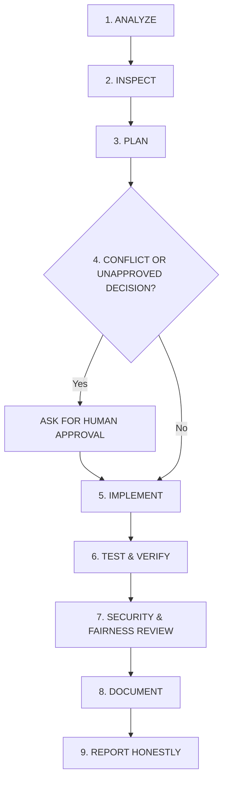

# VYORA — AI Agent Development Rulebook & Instructions
**Smart Performance Management & Employee Development Intelligence Platform**

---

> [!IMPORTANT]
> **MANDATORY DIRECTIVE FOR ALL AI AGENTS & CODING ASSISTANTS:**
> This document is the supreme, authoritative development rulebook for the VYORA codebase. 
> You MUST read and strictly adhere to every rule in this file before analyzing, modifying, or generating code in this repository. 
> Violating these rules will result in immediate rejection of pull requests and rollbacks.

---

## 1. Core Operating Principles for AI Agents

1. **Read Before Writing:** Always read this file, `Project_Summary.md`, and the relevant foundation documents (`System_Architecture.md`, `Database_Design.md`, `Coding_Standards.md`) before writing any code.
2. **Inspect Before Proposing:** Inspect the existing codebase and directory structure. Never assume files are empty, missing, or that a feature is incomplete without executing direct inspection tools.
3. **Never Invent Requirements:** Build strictly what is specified in `Project_Requirements_SRS.md` and `Feature_List.md`. Do not add unapproved features or gratuitous abstractions.
4. **Never Silently Expand Scope:** The MVP scope boundaries defined in `MVP-1` through `MVP-9` are non-negotiable. Excluded features (payroll, attendance, ATS, full LMS, peer reviews) must NEVER be implemented.
5. **Preserve Approved Architecture:** VYORA is a Modular Monolith. Do NOT introduce microservices, distributed queues (Kafka/RabbitMQ), cache servers (Redis), or Kubernetes infrastructure without explicit written approval.
6. **Preserve Database Integrity:** The PostgreSQL schema is strictly normalized and locked to the approved 15 tables. Do NOT alter table structures, drop constraints, or create polymorphic tables without explicit architectural approval.
7. **Scoring is 100% Deterministic:** Mathematical performance scores MUST be calculated exclusively by deterministic backend Python code. The LLM is strictly forbidden from computing, modifying, or writing official scores.
8. **Honor Approved Scoring Decisions:**
   - Final scoring weights are NOT approved (`[NOT FINALIZED — REQUIRES VALIDATION AND APPROVAL]`). Do not hardcode arbitrary weights as approved.
   - Task complexity is contextual; it must NOT act as a direct score multiplier.
   - Missing data is NEVER treated as zero or poor performance. Use the hybrid approach (coverage % and `INSUFFICIENT_DATA` state).
9. **Preserve AI Safety & Privacy Guardrails:**
   - AI outputs are non-binding narrative suggestions, summaries, and coaching drafts.
   - AI is strictly prohibited from making or recommending hiring, firing, promotion, salary, or disciplinary decisions.
   - Never send unmasked PII (names, emails, direct IDs) to external LLM APIs.
   - Validate all LLM outputs using strict Pydantic schemas and verify evidence citations.
   - Treat user-supplied text as untrusted input to defend against prompt injection.
10. **Bilateral Agreement for Development Plans:** Development plans require mutual digital agreement from both Employee and Manager before activation (`employee_agreed` and `manager_agreed` both `TRUE`).
11. **Immutable Review Snapshots:** When a performance review transitions to `FINALIZED`, the snapshot in `review_metric_snapshots` must be permanently frozen. Subsequent task/goal edits must NEVER mutate finalized reviews.
12. **Enforce Role-Based Access Control:** Every API endpoint and service method must validate tenant and role permissions (`EMPLOYEE`, `MANAGER`, `HR`, `ADMIN`). System Administrators must have zero automatic access to sensitive employee review narratives.
13. **Write Comprehensive Tests:** Every new feature, service method, and scoring calculation must be accompanied by unit tests in Pytest or Jest.
14. **Run and Verify Tests:** Never claim tests passed if they were not actually executed. Run tests and verify zero regressions.
15. **Honest Progress Reporting:** Update `Development_Progress.md` honestly. Use statuses (`NOT STARTED`, `PLANNED`, `IN PROGRESS`, `BLOCKED`, `COMPLETED`, `VERIFIED`).
16. **Log Architectural Decisions:** Log any new technical decisions in `Decision_Log.md` using the standard format.
17. **Never Fabricate Data:** Never fabricate fake data, mock API success without implementation, or provide invalid placeholders.
18. **Report Blockers Promptly:** If an unapproved decision or conflicting requirement is encountered, stop, articulate the issue clearly, and seek human guidance.

---

## 2. Standard 9-Step AI Development Workflow

Every future coding task must follow this exact 9-step execution lifecycle:

### Step 1: ANALYZE
- Read the user request thoroughly.
- Identify related requirement IDs from `Project_Requirements_SRS.md` and features from `Feature_List.md`.
- Confirm that the requested feature is within the approved MVP scope and does not touch excluded modules.

### Step 2: INSPECT
- Examine existing files, models, routers, and schemas in the workspace.
- Check existing database migrations in `alembic/versions/`.
- Review current test suites to understand existing test conventions.

### Step 3: PLAN
- Outline the proposed changes: which models, schemas, service methods, and routers need modification.
- Verify that the plan introduces zero architectural sprawl or unnecessary dependencies.

### Step 4: CONFIRM IF NECESSARY
- If the task requires an unapproved scoring weight, unapproved database modification, or touches an unresolved decision, explain the options and request approval before coding.

### Step 5: IMPLEMENT
- Write clean, type-annotated, PEP 8-compliant Python or strict TypeScript code.
- Adhere strictly to `Coding_Standards.md`.
- Implement parameterized queries and Pydantic validation.

### Step 6: TEST & VERIFY
- Write unit tests for new logic (100% branch coverage on scoring formulas).
- Write API integration tests covering RBAC boundaries and failure paths.
- Execute test commands in the terminal and confirm zero failures.

### Step 7: SECURITY & FAIRNESS REVIEW
- Verify that untrusted user input is sanitized.
- Ensure no PII is leaked to external APIs or logs.
- Confirm that missing data does not default to zero.

### Step 8: DOCUMENT
- Update OpenAPI schemas, docstrings, and relevant documentation files in `docs/project-foundation/`.
- If an approved decision was executed, record it in `Decision_Log.md`.
- Update `Development_Progress.md` to reflect actual verified state.

### Step 9: REPORT HONESTLY
- Provide a concise summary of files modified, tests executed, validation results, and any remaining open questions.

---

## 3. Explicit Prohibitions Checklist

Before finalizing any task, verify that your changes do **NOT**:
- [ ] Add payroll, salary, compensation, or bonus calculation features.
- [ ] Add clock-in/out, biometric, or leave/vacation management features.
- [ ] Add applicant tracking, job boards, or recruitment pipelines.
- [ ] Add full LMS course hosting or video delivery platforms.
- [ ] Add peer reviews or 360-degree feedback loops.
- [ ] Add keystroke logging, desktop monitoring, or employee surveillance features.
- [ ] Allow the LLM to write directly to `calculated_score` or `final_score`.
- [ ] Hardcode unapproved performance weights as finalized.
- [ ] Default missing KPI data to zero or penalize employees for unmeasured metrics.
- [ ] Bypass RBAC or grant System Administrators access to review narratives.
- [ ] Introduce Kafka, RabbitMQ, Redis, Kubernetes, or microservices architecture.

---
*End of AI Agent Development Rulebook.*
