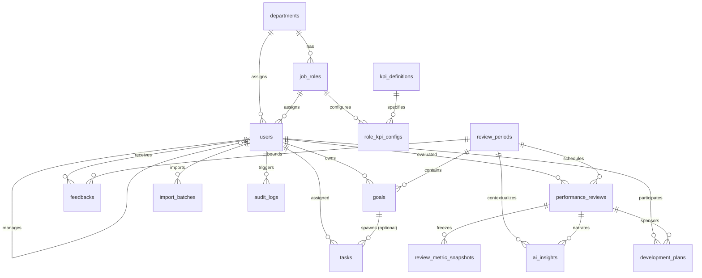

# VYORA — Relational Database Design Document
**Smart Performance Management & Employee Development Intelligence Platform**

---

## 1. Database Philosophy & Design Principles

### 1.1 Core Principles
The VYORA database architecture is engineered for PostgreSQL 15+ using SQLAlchemy ORM and Alembic migrations. The schema strictly enforces:
1. **Third Normal Form (3NF):** Elimination of transitive dependencies, redundancy, and update anomalies across all operational entities.
2. **Deterministic Immutability for Finalized Reviews (DB-7):** Performance reviews are point-in-time assessments. When a review transitions to `FINALIZED`, a dedicated snapshot table (`review_metric_snapshots`) preserves every metric, raw value, normalized score, applied weight, and evidence reference. Subsequent operational modifications to tasks, goals, or role KPI templates will never silently alter finalized historical reviews.
3. **Referential Integrity & Safe Deletions:** Explicit foreign key constraints with appropriate `ON DELETE RESTRICT` or `ON DELETE CASCADE` rules. Soft deletion (`is_active` flags) is reserved strictly for personnel and organizational units to maintain historical referential integrity.
4. **Appropriate Indexing:** Indexing targeted specifically at foreign keys, common filter predicates (`status`, `review_period_id`), and unique constraints.
5. **No Entity Fragmentation or Over-Engineering:** Generic polymorphic tables, EAV (Entity-Attribute-Value) models, and arbitrary NoSQL sprawl are prohibited. JSONB is used judiciously only for flexible configurations, audit logs, import errors, and validated AI outputs.

---

## 2. Entity Catalog & Complexity Audit

Every entity in VYORA is audited below to justify its inclusion in the production-oriented MVP:

| # | Entity Name | Table Name | Business Responsibility | Complexity Audit & Justification |
| :--- | :--- | :--- | :--- | :--- |
| 1 | **Department** | `departments` | Organizational unit grouping employees. | **Essential.** Simplest structure to represent SMB teams; avoids complex graph hierarchies (DB-2). |
| 2 | **Job Role** | `job_roles` | Professional designation defining responsibilities. | **Essential.** Required for role-specific KPI template mapping (DB-2, PS-2). |
| 3 | **User** | `users` | System user, credentials, role, and reporting line. | **Essential.** Consolidates authentication, RBAC profile, and manager assignment into one clean table. |
| 4 | **Review Period** | `review_periods` | Defined monthly evaluation cycle. | **Essential.** Enforces review-period-based evaluation boundaries (DB-1, PS-8). |
| 5 | **Goal** | `goals` | Measurable objective with targets and progress. | **Essential.** Supports manager-assigned and employee-created goals with approval workflow (DB-3). |
| 6 | **Task** | `tasks` | Day-to-day work unit with status, priority, complexity. | **Essential.** Workload and operational evidence. Supports optional goal linking (DB-4). |
| 7 | **KPI Definition** | `kpi_definitions` | Global catalog of quantifiable performance metrics. | **Essential.** Standardizes metrics across categories (`TASK`, `GOAL`, `QUALITY`, etc.). |
| 8 | **Role KPI Config** | `role_kpi_configs` | Maps KPI definitions to specific Job Roles with weights. | **Essential.** Implements shared scoring framework with role-specific KPI configurations (PS-2). |
| 9 | **Feedback** | `feedbacks` | Qualitative manager feedback & employee self-assessments. | **Essential.** Implements lightweight qualitative input; excludes 360-degree peer complexity (DB-5). |
| 10 | **Performance Review** | `performance_reviews` | Formal evaluation record per employee per review period. | **Essential.** Lightweight formal review entity supporting scores and finalization state (DB-6). |
| 11 | **Review Metric Snapshot** | `review_metric_snapshots` | Immutable record of metrics and weights at finalization. | **Essential.** Guarantees historical stability; frozen snapshot of finalized reviews (DB-7). |
| 12 | **AI Insight** | `ai_insights` | Validated, structured AI narrative and recommendations. | **Essential.** Stores generated explanations, strengths, and allows user flagging (AI-5, AI-8). |
| 13 | **Development Plan** | `development_plans` | Joint employee-manager action plan and milestones. | **Essential.** Actionable growth platform; requires mutual agreement (AI-6, BR-010). |
| 14 | **Import Batch** | `import_batches` | Audit ledger for bulk CSV/Excel onboarding files. | **Essential.** Required for robust SMB employee onboarding error reporting (MVP-3). |
| 15 | **Audit Log** | `audit_logs` | Immutable security and operational audit trail. | **Essential.** Tracks security events, role changes, and finalization actions (NFR-013). |

---

## 3. Detailed Data Dictionary

### 3.1 `departments`
Groups employees into organizational business units.
- `id` (UUID, PK): Unique department identifier (`gen_random_uuid()`).
- `name` (VARCHAR(100), NOT NULL, UNIQUE): Unique department name (e.g., "Engineering", "Sales").
- `code` (VARCHAR(20), NOT NULL, UNIQUE): Short code (e.g., "ENG", "SALES").
- `description` (TEXT, NULLABLE): Department scope description.
- `is_active` (BOOLEAN, NOT NULL, DEFAULT TRUE): Soft-delete flag.
- `created_at` (TIMESTAMPTZ, NOT NULL, DEFAULT NOW()): Creation timestamp.
- `updated_at` (TIMESTAMPTZ, NOT NULL, DEFAULT NOW()): Update timestamp.

### 3.2 `job_roles`
Defines professional designations within departments.
- `id` (UUID, PK): Unique role identifier.
- `department_id` (UUID, FK -> `departments.id`, NOT NULL): Parent department.
- `name` (VARCHAR(100), NOT NULL): Role title (e.g., "Senior Backend Engineer").
- `code` (VARCHAR(30), NOT NULL, UNIQUE): Identifier code (e.g., "SWE_SR_BACKEND").
- `description` (TEXT, NULLABLE): Job responsibilities description.
- `is_active` (BOOLEAN, NOT NULL, DEFAULT TRUE): Soft-delete flag.
- `created_at` (TIMESTAMPTZ, NOT NULL, DEFAULT NOW()): Creation timestamp.
- `updated_at` (TIMESTAMPTZ, NOT NULL, DEFAULT NOW()): Update timestamp.

### 3.3 `users`
Unified entity for authentication, profile, RBAC, and reporting structure.
- `id` (UUID, PK): Unique user identifier.
- `email` (VARCHAR(255), NOT NULL, UNIQUE): User login email.
- `password_hash` (VARCHAR(255), NOT NULL): Argon2id/bcrypt hashed password.
- `full_name` (VARCHAR(150), NOT NULL): Employee full name.
- `role` (VARCHAR(30), NOT NULL): System role (`EMPLOYEE`, `MANAGER`, `HR`, `ADMIN`).
- `department_id` (UUID, FK -> `departments.id`, NULLABLE): Assigned department.
- `job_role_id` (UUID, FK -> `job_roles.id`, NULLABLE): Assigned job role.
- `manager_id` (UUID, FK -> `users.id`, NULLABLE): Assigned manager (self-referencing FK).
- `is_active` (BOOLEAN, NOT NULL, DEFAULT TRUE): Active employment flag.
- `created_at` (TIMESTAMPTZ, NOT NULL, DEFAULT NOW()): Creation timestamp.
- `updated_at` (TIMESTAMPTZ, NOT NULL, DEFAULT NOW()): Update timestamp.
- *Constraints:* Check constraint `users_role_check` on valid enum strings; self-reference foreign key `fk_users_manager`.

### 3.4 `review_periods`
Defines the formal review timeframe (typically monthly).
- `id` (UUID, PK): Unique review period identifier.
- `name` (VARCHAR(100), NOT NULL): Period name (e.g., "November 2026 Review").
- `start_date` (DATE, NOT NULL): Period start boundary.
- `end_date` (DATE, NOT NULL): Period end boundary.
- `review_month` (VARCHAR(7), NOT NULL, UNIQUE): Formatted month identifier (e.g., "2026-11").
- `status` (VARCHAR(30), NOT NULL, DEFAULT 'UPCOMING'): Lifecycle state (`UPCOMING`, `ACTIVE`, `UNDER_REVIEW`, `COMPLETED`, `ARCHIVED`).
- `created_at` (TIMESTAMPTZ, NOT NULL, DEFAULT NOW()): Creation timestamp.
- `updated_at` (TIMESTAMPTZ, NOT NULL, DEFAULT NOW()): Update timestamp.
- *Constraints:* Check constraint `end_date >= start_date`.

### 3.5 `goals`
Strategic and operational objectives.
- `id` (UUID, PK): Unique goal identifier.
- `employee_id` (UUID, FK -> `users.id`, NOT NULL): Goal owner.
- `created_by_id` (UUID, FK -> `users.id`, NOT NULL): Creator (manager or employee).
- `review_period_id` (UUID, FK -> `review_periods.id`, NOT NULL): Associated review period.
- `title` (VARCHAR(255), NOT NULL): Goal summary.
- `description` (TEXT, NULLABLE): Specific objective details.
- `category` (VARCHAR(50), NOT NULL): Category (e.g., "PROJECT", "PROFESSIONAL_GROWTH", "EFFICIENCY").
- `target_metric` (VARCHAR(100), NOT NULL): Measurement metric name.
- `start_value` (NUMERIC(10,2), NOT NULL, DEFAULT 0.00): Starting baseline value.
- `target_value` (NUMERIC(10,2), NOT NULL): Target target value.
- `current_value` (NUMERIC(10,2), NOT NULL, DEFAULT 0.00): Recorded progress value.
- `unit` (VARCHAR(30), NOT NULL, DEFAULT 'percent'): Unit of measure (e.g., "percent", "count", "currency").
- `status` (VARCHAR(30), NOT NULL, DEFAULT 'ACTIVE'): Lifecycle state (`DRAFT`, `PENDING_APPROVAL`, `ACTIVE`, `COMPLETED`, `CANCELLED`).
- `approval_status` (VARCHAR(30), NOT NULL, DEFAULT 'APPROVED'): Approval state (`PENDING`, `APPROVED`, `REJECTED`).
- `approved_by_id` (UUID, FK -> `users.id`, NULLABLE): Manager who approved/rejected.
- `rejection_reason` (TEXT, NULLABLE): Explanation if rejected.
- `due_date` (DATE, NOT NULL): Target completion date.
- `created_at` (TIMESTAMPTZ, NOT NULL, DEFAULT NOW()): Creation timestamp.
- `updated_at` (TIMESTAMPTZ, NOT NULL, DEFAULT NOW()): Update timestamp.

### 3.6 `tasks`
Operational task units representing daily evidence.
- `id` (UUID, PK): Unique task identifier.
- `employee_id` (UUID, FK -> `users.id`, NOT NULL): Assigned employee.
- `assigned_by_id` (UUID, FK -> `users.id`, NOT NULL): Assigning user.
- `goal_id` (UUID, FK -> `goals.id`, NULLABLE): Optional associated goal (DB-4).
- `title` (VARCHAR(255), NOT NULL): Task name.
- `description` (TEXT, NULLABLE): Detailed task requirements.
- `status` (VARCHAR(30), NOT NULL, DEFAULT 'TODO'): Status (`TODO`, `IN_PROGRESS`, `BLOCKED`, `COMPLETED`, `CANCELLED`).
- `priority` (VARCHAR(20), NOT NULL, DEFAULT 'MEDIUM'): Priority (`LOW`, `MEDIUM`, `HIGH`, `URGENT`).
- `complexity` (VARCHAR(20), NOT NULL, DEFAULT 'MEDIUM'): Complexity tag (`LOW`, `MEDIUM`, `HIGH`) (PS-4).
- `due_date` (TIMESTAMPTZ, NOT NULL): Target completion deadline.
- `completed_at` (TIMESTAMPTZ, NULLABLE): Actual completion timestamp.
- `is_reopened` (BOOLEAN, NOT NULL, DEFAULT FALSE): Reopened flag.
- `blocked_reason` (TEXT, NULLABLE): Mandatory explanation if status is `BLOCKED`.
- `created_at` (TIMESTAMPTZ, NOT NULL, DEFAULT NOW()): Creation timestamp.
- `updated_at` (TIMESTAMPTZ, NOT NULL, DEFAULT NOW()): Update timestamp.

### 3.7 `kpi_definitions`
Standard catalog of performance metrics.
- `id` (UUID, PK): Unique KPI definition identifier.
- `code` (VARCHAR(50), NOT NULL, UNIQUE): Unique KPI code (e.g., `TASK_COMPLETION_RATE`, `DEADLINE_ADHERENCE`).
- `name` (VARCHAR(150), NOT NULL): Human-readable name.
- `description` (TEXT, NOT NULL): Metric explanation and formula summary.
- `category` (VARCHAR(30), NOT NULL): KPI category (`TASK`, `GOAL`, `QUALITY`, `CONSISTENCY`, `DEADLINE`).
- `unit` (VARCHAR(30), NOT NULL, DEFAULT 'percentage'): Unit of measurement.
- `is_active` (BOOLEAN, NOT NULL, DEFAULT TRUE): Active indicator.
- `created_at` (TIMESTAMPTZ, NOT NULL, DEFAULT NOW()): Creation timestamp.
- `updated_at` (TIMESTAMPTZ, NOT NULL, DEFAULT NOW()): Update timestamp.

### 3.8 `role_kpi_configs`
Configures which KPIs apply to specific job roles, including default weights and evidence thresholds.
- `id` (UUID, PK): Unique configuration identifier.
- `job_role_id` (UUID, FK -> `job_roles.id`, NOT NULL): Target job role.
- `kpi_definition_id` (UUID, FK -> `kpi_definitions.id`, NOT NULL): Configured KPI.
- `default_weight` (NUMERIC(5,2), NOT NULL): Configured weight percentage (e.g., 25.00).
- `min_evidence_threshold` (INTEGER, NOT NULL, DEFAULT 3): Minimum evidence items required for valid calculation.
- `is_mandatory` (BOOLEAN, NOT NULL, DEFAULT TRUE): Flag indicating if metric is essential for role evaluation.
- `created_at` (TIMESTAMPTZ, NOT NULL, DEFAULT NOW()): Creation timestamp.
- `updated_at` (TIMESTAMPTZ, NOT NULL, DEFAULT NOW()): Update timestamp.
- *Constraints:* UNIQUE(`job_role_id`, `kpi_definition_id`).

### 3.9 `feedbacks`
Qualitative evaluations supporting formal reviews.
- `id` (UUID, PK): Unique feedback identifier.
- `employee_id` (UUID, FK -> `users.id`, NOT NULL): Subject employee.
- `author_id` (UUID, FK -> `users.id`, NOT NULL): Author (manager or self).
- `review_period_id` (UUID, FK -> `review_periods.id`, NOT NULL): Target review period.
- `feedback_type` (VARCHAR(30), NOT NULL): Type (`MANAGER_TO_EMPLOYEE`, `SELF_ASSESSMENT`) (DB-5).
- `content` (TEXT, NOT NULL): Main qualitative evaluation body.
- `strengths` (TEXT, NULLABLE): Specific observed strengths.
- `growth_areas` (TEXT, NULLABLE): Identified opportunities for improvement.
- `created_at` (TIMESTAMPTZ, NOT NULL, DEFAULT NOW()): Creation timestamp.
- `updated_at` (TIMESTAMPTZ, NOT NULL, DEFAULT NOW()): Update timestamp.

### 3.10 `performance_reviews`
The central formal review entity per employee per review period (DB-6).
- `id` (UUID, PK): Unique review identifier.
- `employee_id` (UUID, FK -> `users.id`, NOT NULL): Evaluated employee.
- `reviewer_id` (UUID, FK -> `users.id`, NOT NULL): Evaluating manager.
- `review_period_id` (UUID, FK -> `review_periods.id`, NOT NULL): Period under review.
- `status` (VARCHAR(30), NOT NULL, DEFAULT 'DRAFT'): Review state (`DRAFT`, `SUBMITTED`, `FINALIZED`).
- `score_status` (VARCHAR(30), NOT NULL, DEFAULT 'CALCULATED'): Status (`CALCULATED`, `INSUFFICIENT_DATA`).
- `calculated_score` (NUMERIC(5,2), NULLABLE): Deterministic composite score (0.00–100.00). Null if insufficient data.
- `final_score` (NUMERIC(5,2), NULLABLE): Official approved score upon finalization.
- `data_coverage_percentage` (NUMERIC(5,2), NOT NULL): Proportion of eligible weighted evidence available.
- `manager_summary` (TEXT, NULLABLE): Formal manager remarks.
- `employee_remarks` (TEXT, NULLABLE): Employee sign-off response.
- `finalized_at` (TIMESTAMPTZ, NULLABLE): Timestamp of finalization locking.
- `created_at` (TIMESTAMPTZ, NOT NULL, DEFAULT NOW()): Creation timestamp.
- `updated_at` (TIMESTAMPTZ, NOT NULL, DEFAULT NOW()): Update timestamp.
- *Constraints:* UNIQUE(`employee_id`, `review_period_id`).

### 3.11 `review_metric_snapshots`
Immutable historical snapshot table for finalized reviews (DB-7).
- `id` (UUID, PK): Unique snapshot item identifier.
- `performance_review_id` (UUID, FK -> `performance_reviews.id`, NOT NULL): Parent finalized review.
- `kpi_code` (VARCHAR(50), NOT NULL): Snapshot KPI code.
- `kpi_name` (VARCHAR(150), NOT NULL): Snapshot KPI name.
- `category` (VARCHAR(30), NOT NULL): Snapshot KPI category.
- `raw_value` (NUMERIC(10,2), NULLABLE): Raw unnormalized measurement.
- `normalized_score` (NUMERIC(5,2), NULLABLE): Normalized 0–100 score.
- `applied_weight` (NUMERIC(5,2), NOT NULL): Weight percentage utilized in calculation.
- `evidence_count` (INTEGER, NOT NULL): Number of evidence items audited.
- `is_sufficient` (BOOLEAN, NOT NULL): Whether evidence count met threshold.
- `data_status` (VARCHAR(20), NOT NULL): Status (`AVAILABLE`, `NOT_AVAILABLE`, `INSUFFICIENT`).
- `snapshot_data` (JSONB, NOT NULL): Full frozen JSON context (formula, thresholds, evidence IDs).
- `created_at` (TIMESTAMPTZ, NOT NULL, DEFAULT NOW()): Snapshot recording timestamp.

### 3.12 `ai_insights`
Stores structured, schema-validated AI narrative outputs.
- `id` (UUID, PK): Unique insight identifier.
- `employee_id` (UUID, FK -> `users.id`, NOT NULL): Subject employee.
- `performance_review_id` (UUID, FK -> `performance_reviews.id`, NULLABLE): Related review record.
- `review_period_id` (UUID, FK -> `review_periods.id`, NOT NULL): Associated review period.
- `prompt_version` (VARCHAR(50), NOT NULL): Version of prompt template used.
- `model_version` (VARCHAR(50), NOT NULL): LLM model identifier (e.g., `gemini-1.5-pro-002`).
- `structured_output` (JSONB, NOT NULL): Full validated JSON output matching `AIInsightOutputSchema`.
- `status` (VARCHAR(30), NOT NULL, DEFAULT 'GENERATED'): Status (`GENERATED`, `FLAGGED`, `REVIEWED`).
- `flag_reason` (TEXT, NULLABLE): User explanation if insight is flagged as inaccurate (AI-8).
- `flagged_by_id` (UUID, FK -> `users.id`, NULLABLE): User who flagged the insight.
- `created_at` (TIMESTAMPTZ, NOT NULL, DEFAULT NOW()): Creation timestamp.
- `updated_at` (TIMESTAMPTZ, NOT NULL, DEFAULT NOW()): Update timestamp.

### 3.13 `development_plans`
Collaborative growth plans establishing milestones and actions.
- `id` (UUID, PK): Unique plan identifier.
- `employee_id` (UUID, FK -> `users.id`, NOT NULL): Subject employee.
- `manager_id` (UUID, FK -> `users.id`, NOT NULL): Supervising manager.
- `review_period_id` (UUID, FK -> `review_periods.id`, NULLABLE): Sponsoring review period.
- `ai_insight_id` (UUID, FK -> `ai_insights.id`, NULLABLE): Source AI recommendation reference.
- `title` (VARCHAR(255), NOT NULL): Development initiative title.
- `objective` (TEXT, NOT NULL): Growth objective and target capabilities.
- `status` (VARCHAR(30), NOT NULL, DEFAULT 'DRAFT'): Lifecycle state (`DRAFT`, `PROPOSED`, `IN_PROGRESS`, `COMPLETED`, `REJECTED`).
- `employee_agreed` (BOOLEAN, NOT NULL, DEFAULT FALSE): Employee digital agreement flag (BR-010).
- `manager_agreed` (BOOLEAN, NOT NULL, DEFAULT FALSE): Manager digital agreement flag (BR-010).
- `action_items` (JSONB, NOT NULL, DEFAULT '[]'::jsonb): Structured action items list with milestones and deadlines.
- `start_date` (DATE, NOT NULL): Plan activation date.
- `target_completion_date` (DATE, NOT NULL): Target completion date.
- `completed_at` (TIMESTAMPTZ, NULLABLE): Actual plan completion timestamp.
- `created_at` (TIMESTAMPTZ, NOT NULL, DEFAULT NOW()): Creation timestamp.
- `updated_at` (TIMESTAMPTZ, NOT NULL, DEFAULT NOW()): Update timestamp.

### 3.14 `import_batches`
Audit log and error ledger for bulk employee onboarding files.
- `id` (UUID, PK): Unique import batch identifier.
- `imported_by_id` (UUID, FK -> `users.id`, NOT NULL): HR user initiating import.
- `entity_type` (VARCHAR(50), NOT NULL, DEFAULT 'EMPLOYEE'): Imported entity type.
- `file_name` (VARCHAR(255), NOT NULL): Uploaded file name.
- `total_rows` (INTEGER, NOT NULL): Total rows parsed from file.
- `successful_rows` (INTEGER, NOT NULL): Successfully imported row count.
- `failed_rows` (INTEGER, NOT NULL): Rejected row count.
- `error_log` (JSONB, NOT NULL, DEFAULT '[]'::jsonb): Detailed array of row errors `[{row: 4, email: "...", error: "Invalid role"}]`.
- `created_at` (TIMESTAMPTZ, NOT NULL, DEFAULT NOW()): Import timestamp.

### 3.15 `audit_logs`
Immutable administrative and security audit trail.
- `id` (UUID, PK): Unique log identifier.
- `user_id` (UUID, FK -> `users.id`, NULLABLE): User who initiated the action.
- `action` (VARCHAR(100), NOT NULL): Action identifier (e.g., `USER_LOGIN_FAILED`, `REVIEW_FINALIZED`, `ROLE_UPDATED`).
- `entity_type` (VARCHAR(50), NOT NULL): Affected table or domain entity.
- `entity_id` (UUID, NULLABLE): Primary key of affected entity.
- `ip_address` (VARCHAR(45), NULLABLE): Client IP address.
- `changes` (JSONB, NULLABLE): Old vs. new values for tracked mutations.
- `created_at` (TIMESTAMPTZ, NOT NULL, DEFAULT NOW()): Event timestamp.

---

## 4. Entity Relationships & Cardinality

---
*End of Relational Database Design Document.*
