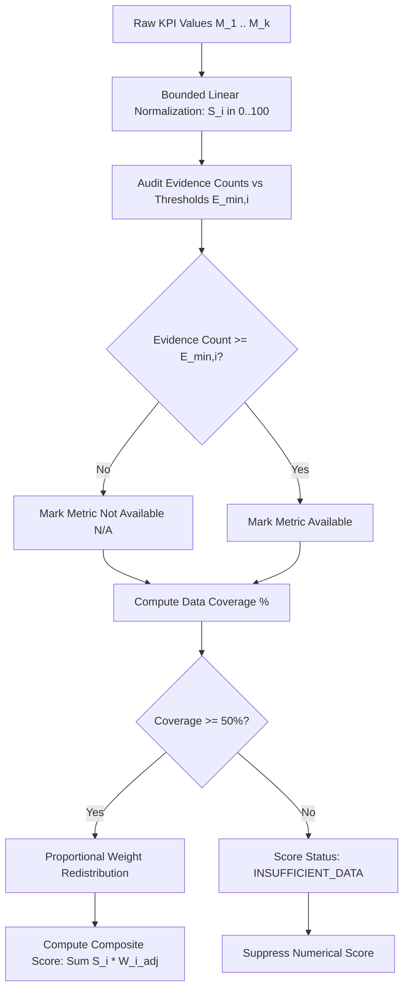

# VYORA — Performance Scoring & Analytics Engine Design
**Smart Performance Management & Employee Development Intelligence Platform**

---

## 1. Executive Summary & Authoritative Principles

The VYORA Performance Scoring Engine is engineered as a **100% deterministic, backend-controlled computational module**. 
Large Language Models (LLMs) are **strictly prohibited** from computing, adjusting, or modifying official performance scores. AI is utilized exclusively as a qualitative, natural language explanation and coaching layer after deterministic metrics are finalized.

### Core Scoring Principles
1. **Mathematical Determinism:** Every performance score is calculated by pure Python algorithms with full traceability.
2. **Context-Aware Workload Sensitivity (PS-4):** Task complexity (Low, Medium, High) provides contextual interpretation of workload and does **NOT** directly increase or decrease an employee's numerical score.
3. **Evidence-Based Grounding (PS-1):** Scores reflect tangible operational artifacts: task completions, goal milestones, validated quality assessments, and deadline timeliness.
4. **Hybrid Missing Data & Coverage Audit (PS-7):** Missing data is **never** treated as zero or interpreted as poor performance. Metrics lacking sufficient evidence are marked `Not Available`. If overall data coverage is $<50\%$, numerical composite scoring is suppressed, transitioning the review to an explicit `INSUFFICIENT_DATA` state.
5. **Role-Specific Nuance (PS-2):** Evaluates employees according to role-specific KPI templates configured by HR (e.g., Software Engineers have distinct quality metrics from Customer Success or Sales).
6. **Immutable Historical Freezing (DB-7):** When a performance review transitions to `FINALIZED`, a frozen snapshot of raw metrics, applied weights, normalization versions, and evidence counts is preserved in `review_metric_snapshots`.

---

## 2. Approved vs. Proposed Scoring Decisions

| Topic | Status | Approved Detail / Proposed Recommendation | Reference |
| :--- | :---: | :--- | :--- |
| **Scoring Authority** | **`[APPROVED]`** | 100% deterministic backend calculation; AI never computes official scores. | PS-1, AI-7 |
| **Framework Dimensions** | **`[APPROVED]`** | Combines Task Performance, Goal Achievement, Quality, Consistency, and Deadlines. | PS-1 |
| **Role Nuance** | **`[APPROVED]`** | Shared base framework with role-specific KPI configurations. | PS-2 |
| **Task Complexity** | **`[APPROVED]`** | Complexity is contextual only; no arbitrary numerical score multipliers. | PS-4 |
| **Missing Data Policy** | **`[APPROVED]`** | Hybrid: Missing != 0; unmeasured = N/A; coverage <50% = `INSUFFICIENT_DATA`. | PS-7 |
| **Review Cadence** | **`[APPROVED]`** | Monthly formal reviews with continuous underlying operational analytics. | PS-8 |
| **Final Scoring Weights** | **`[NOT FINALIZED — REQUIRES VALIDATION AND APPROVAL]`** | Sample weights (Goal 30%, Task 25%, Deadline 20%, Quality 15%, Consistency 10%) are unapproved baseline proposals. | PS-3 |
| **Deadline Scoring Formula** | **`[PROPOSED — REQUIRES APPROVAL]`** | Proposed: Blocker-aware on-time delivery rate with 24-hour grace window. | PS-5 |
| **Quality Metrics Formula** | **`[PROPOSED — REQUIRES APPROVAL]`** | Proposed: Role-appropriate defect/rework or manager quality rating. | PS-6 |

---

## 3. Mathematical Formulation of Metrics

### 3.1 Task Completion Rate ($M_{TC}$)
Measures execution velocity over scheduled work in the review period:
$$M_{TC} = \left( \frac{N_{\text{completed}}}{N_{\text{scheduled}}} \right) \times 100$$
- $N_{\text{completed}}$: Tasks completed within the review period.
- $N_{\text{scheduled}}$: All tasks due or scheduled in the review period (excluding cancelled tasks).
- *Minimum Evidence Threshold:* 5 tasks.

### 3.2 Goal Milestone Achievement Rate ($M_{GA}$)
Measures progress across active strategic and operational goals:
$$M_{GA} = \frac{1}{|G|} \sum_{g \in G} \text{Progress}(g)$$
Where individual goal progress is bounded:
$$\text{Progress}(g) = \min\left(100, \max\left(0, \frac{\text{Current Value} - \text{Start Value}}{\text{Target Value} - \text{Start Value}} \times 100\right)\right)$$
- *Minimum Evidence Threshold:* 1 active goal.

### 3.3 On-Time Delivery / Deadline Adherence ($M_{OT}$) — `[PROPOSED — REQUIRES APPROVAL]`
Measures adherence to deadlines with blocker-awareness:
$$M_{OT} = \left( \frac{N_{\text{on-time}}}{N_{\text{completed}}} \right) \times 100$$
- A task is considered on-time if:
  $$\text{completed\_at} \le \text{due\_date} + \text{Grace Period (24h)} + \text{Documented Blocker Duration}$$
- *Minimum Evidence Threshold:* 5 completed tasks.

### 3.4 Role-Appropriate Quality Index ($M_{Q}$) — `[PROPOSED — REQUIRES APPROVAL]`
- **Software Engineering:** Based on code review acceptance and defect rework rate:
  $$M_{Q} = \max\left(0, 100 - (\text{Rework Rate} \times 100)\right)$$
- **Customer Success / Support:** Based on CSAT percentage score.
- **General Knowledge Worker:** Manager structured quality rating (1–5 scale normalized to 0–100).
- *Minimum Evidence Threshold:* 3 evaluated outputs/reviews.

### 3.5 Operational Consistency ($M_{C}$)
Measures cadence stability across weeks in the monthly cycle:
$$M_{C} = 100 - \min\left(50, \text{StdDev}(\text{Weekly Task Completions}) \times 10\right)$$
- *Minimum Evidence Threshold:* 8 completed tasks across at least 3 distinct weeks.

---

## 4. Normalization & Hybrid Coverage Algorithm

### 4.1 Bounded Linear Normalization
Raw metrics are projected into a standard 0–100 scale:
$$S_i = \min\left(100, \max\left(0, \frac{M_i - M_{i,\min}}{M_{i,\max} - M_{i,\min}} \times 100\right)\right)$$

### 4.2 Data Coverage Audit
$$\text{Coverage \%} = \frac{\sum_{i \in \text{Available}} W_i}{\sum_{j \in \text{Configured}} W_j} \times 100$$

### 4.3 Proportional Weight Redistribution
When coverage $\ge 50\%$, weights are adjusted across eligible metrics:
$$W_{i,\text{adj}} = \frac{W_i}{\sum_{j \in \text{Available}} W_j}$$
$$\text{Final Composite Score} = \sum_{i \in \text{Available}} \left( S_i \times W_{i,\text{adj}} \right)$$

---

## 5. Workload Context Engine

Workload indicators provide context to explain why delivery pace or task completion may vary:
- **Active Task Load:** Current concurrently open tasks.
- **Complexity Breakdown:** Count of `HIGH`, `MEDIUM`, and `LOW` complexity tasks.
- **Workload Status Badge:**
  - `NORMAL`: Active tasks within role baseline (e.g., 3–8 tasks).
  - `HIGH_WORKLOAD`: Active tasks exceeding baseline by 25–50%.
  - `OVERLOADED`: Active tasks exceeding baseline by > 50% or multiple high-complexity tasks blocked.
- *Strict Rule:* Workload badges are displayed as contextual indicators only and do **NOT** directly alter numerical scores.

---
*End of Performance Scoring & Analytics Engine Design.*
