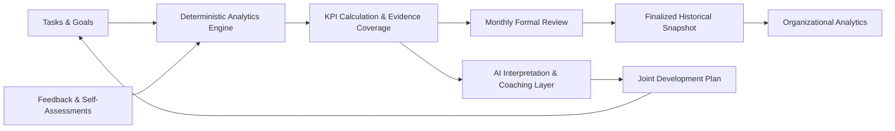
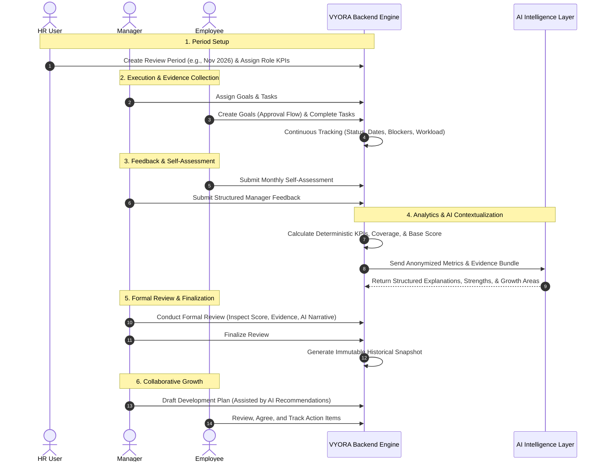

# VYORA — Project Overview
**Smart Performance Management & Employee Development Intelligence Platform**

---

## 1. Document Control
- **Document Version:** 1.0.0
- **Status:** APPROVED BASELINE
- **Date:** 2026-11-21
- **Domain:** HR Tech / People Analytics / Performance Intelligence
- **Target Audience:** Engineering, Product, Operations, and Business Stakeholders

---

## 2. Project Identity
- **Working Project Name:** VYORA *(Working name; not yet trademark/domain verified. No trademark or availability claims are made).*
- **Full Project Name:** Smart Performance Management & Employee Development Intelligence Platform
- **Product Domain:** HR Tech / People Analytics / Employee Growth & Performance Intelligence
- **Product Type:** Web-based, AI-assisted, contextual performance evaluation and personalized employee development platform.
- **Target Market:** Small and Medium-Sized Businesses (SMBs) with 20 to 500 knowledge and service workers.

---

## 3. Product Vision & Philosophy
> *"Don't just measure employee performance. Understand it, explain it, identify risks early, and help people improve."*

Traditional performance management relies on backward-looking, subjective annual or quarterly reviews where managers assign arbitrary numerical scores. VYORA fundamentally transforms this dynamic. It treats performance evaluation not as an annual grading ceremony or an employee surveillance mechanism, but as a continuous, transparent, evidence-grounded feedback and coaching cycle.

### Core Philosophy:
1. **Explainability Over Obscurity:** A number without context is meaningless. Every score must be accompanied by its underlying calculation, evidence count, and narrative explanation.
2. **Context-Aware Fairness:** Workload spikes, blocked dependencies, task complexities, and data gaps directly affect observable outcomes. VYORA ensures context is visible, preventing unfair conclusions.
3. **Growth Over Punishment:** VYORA explicitly decouples performance intelligence from punitive surveillance. It uses insights to generate mutual employee-manager development actions, skill coaching, and structured support.
4. **Deterministic Authority, AI Interpretation:** Mathematical metrics and scores are strictly calculated by deterministic backend algorithms. Generative AI is restricted to qualitative summarization, context explanation, and personalized coaching recommendations. AI never calculates scores or makes autonomous employment decisions.

---

## 4. Problem Statement
Small and medium-sized enterprises encounter systemic failures in traditional performance management:
- **Delayed & Infrequent Reviews:** Annual or quarterly cycles mean feedback arrives months after work is completed, rendering coaching irrelevant.
- **Subjective & Biased Ratings:** Manager evaluations often depend on recency bias, personal affinity, and halo/horns effects rather than documented output.
- **Simplistic Score Aggregation:** Flattening diverse employee activities into a single "4.2 out of 5" score hides specific strengths and bottlenecks.
- **Raw Task-Count Distortion:** Treating all tasks as equal rewards low-complexity ticket churn over high-impact, complex problem-solving.
- **Ignoring Workload & Blockers:** High workload or third-party blockers frequently cause delivery delays, yet traditional tools penalize the employee without context.
- **Disconnected Work Artifacts:** Daily tasks, high-level quarterly goals, and feedback notes live in siloed spreadsheets or disconnected tools.
- **Opaque Calculations:** Employees are presented with finalized ratings without visibility into the math, criteria, or evidence used.
- **Lack of Actionable Improvement:** Feedback rarely translates into structured development or concrete training pathways.
- **Unaddressed Missing Data:** Missing inputs are either arbitrarily penalized as zeroes or ignored, skewing team analytics.

---

## 5. The VYORA Solution
VYORA provides a unified, continuous performance intelligence platform that connects day-to-day operational evidence with monthly formal reviews and collaborative employee development.

### Key Capabilities:
- **Evidence-Grounded Evaluation:** Monthly reviews synthesize verified task progress, goal milestones, and qualitative feedback.
- **Workload & Complexity Context:** Displays active task distribution and complexity indicators as context alongside metrics without arbitrary numerical score distortions.
- **Hybrid Data Coverage Handling:** Distinguishes between zero performance, incomplete data, and unmeasured KPIs. Marks metrics with insufficient evidence as `Not Available` rather than falsely penalizing workers.
- **AI-Assisted Narrative & Coaching:** Generates structured explanations, identifies observed patterns, and drafts personalized development suggestions grounded solely in supplied facts.
- **Collaborative Development Plans:** Employees and managers jointly refine, agree upon, and track actionable growth plans.
- **Immutable Historical Snapshots:** Freezes full configuration, metrics, evidence references, and scores upon review finalization to guarantee historical integrity.

---

## 6. Product Differentiation
| Dimension | Traditional HR Tools / Spreadsheets | Generic Enterprise PM Suites | VYORA Intelligence Platform |
| :--- | :--- | :--- | :--- |
| **Evaluation Frequency** | Annual or bi-annual | Quarterly or bi-annual | Continuous analytics with monthly formal reviews |
| **Scoring Logic** | Arbitrary manager rating | Rigid, opaque global formulas | Deterministic base framework + role-specific KPIs + data coverage audit |
| **Workload Sensitivity** | Ignored | Often viewed as "productivity volume" | Explicit contextual factor preventing unfair penalization |
| **Role Nuance** | One-size-fits-all forms | Complex, multi-year workflow setup | Role-specific KPI templates tailored to job functions |
| **AI Integration** | None or ungrounded chatbots | Generic auto-complete text | Strictly grounded, schema-validated insights with evidence tracing |
| **Development Linkage** | Disconnected LMS or non-existent | Enterprise compliance tracking | Direct, collaborative Employee-Manager action plans |
| **Surveillance Stance** | Keystroke/activity tracking common | Heavy process overhead | Strictly outcome- and evidence-based; zero surveillance |

---

## 7. Target User Roles & Permissions
VYORA supports four core system roles with strict boundary enforcement:

### 7.1 Employee
- **Core Needs:** Clarity on expectations, fair evaluation, visible evidence, actionable development pathways, and psychological safety.
- **Key Capabilities:**
  - View job role expectations, assigned goals, and role-specific KPIs.
  - Create personal goals (subject to manager approval) and self-managed tasks.
  - Track goal progress, completed tasks, and monthly performance score breakdowns.
  - Access AI-generated explanations, strengths, and recommended development actions.
  - Complete monthly self-assessments.
  - Actively participate in, review, and mark progress on agreed Development Plans.
  - Flag inaccurate AI insights or factual discrepancies.

### 7.2 Manager / Team Leader
- **Core Needs:** Objective visibility into team performance, workload balance, early identification of struggling employees, and coaching support.
- **Key Capabilities:**
  - Manage direct team members within their authorized departmental/team boundary.
  - Assign organizational goals and review/approve employee-initiated goals.
  - Assign tasks, track progress, review blockers, and log qualitative feedback.
  - Conduct monthly performance reviews with deterministic score breakdowns.
  - Review self-assessments alongside objective evidence.
  - Review AI-generated narrative summaries, strengths, and risk patterns.
  - Propose, edit, and approve collaborative Development Plans.
  - Export department/team review summaries.

### 7.3 Human Resources (HR)
- **Core Needs:** Organizational alignment, standardized evaluation criteria, cross-department trend analysis, and governance.
- **Key Capabilities:**
  - Manage organizational structure: departments, designations/job roles, and manager assignments.
  - Configure global review periods (calendar months).
  - Define role-specific KPI templates, metric libraries, and threshold rules.
  - Monitor organization-wide review completion and rating distributions.
  - Identify systemic skill gaps and organizational training priorities.
  - Manage employee onboarding via manual entry and validated CSV/Excel batch imports.

### 7.4 System Administrator
- **Core Needs:** System availability, security, tenant settings, access control, and operational auditability.
- **Key Capabilities:**
  - Manage user accounts, role assignments, and authentication policies.
  - Configure system-level parameters (AI model selection, token limits, data retention).
  - Monitor technical system health, background jobs, and error logs.
  - Inspect comprehensive security and audit logs.
  - *Boundary Rule:* Administrators have zero automatic access to view or modify sensitive employee performance content unless explicitly authorized for HR audit duties.

---

## 8. Core End-to-End Workflow

---

## 9. Scope Boundaries

### 9.1 In-Scope for MVP
1. **Multi-Role Authentication & Authorization:** Secure JWT-based RBAC for Employee, Manager, HR, and Admin.
2. **Organization & Employee Directory:** Departments, job roles, manager hierarchy, and CSV/Excel batch onboarding.
3. **Goal & Task Management:** Dual-origin goals (manager assigned & employee initiated), optional task-to-goal linking, task priorities, status tracking, and complexity tagging.
4. **Deterministic Scoring Engine:** Monthly formal reviews, role-specific KPI configurations, hybrid missing data handling, and evidence coverage audits.
5. **Workload Contextualization:** Active/pending task counts and complexity metrics displayed as interpretive context.
6. **Qualitative Feedback Loop:** Structured manager-to-employee feedback and employee self-assessments.
7. **Secure AI Intelligence Layer:** Anonymized prompt generation, schema-validated JSON responses, grounded narrative explanations, and human-in-the-loop validation.
8. **Collaborative Development Plans:** Action plans created jointly by manager and employee with milestone tracking.
9. **Role-Specific Dashboards:** Personalized dashboards for all 4 roles with score visualizations, trend charts, and status indicators.
10. **Immutable Review Snapshots & Audit Logging:** Snapshot storage for finalized reviews and tamper-evident administrative audit logs.

### 9.2 Explicit Exclusions (Out of Scope)
To maintain focus, velocity, and strict respect for product boundaries, the following are **strictly excluded**:
- **Payroll, Compensation, & Benefits:** No salary management, bonus computations, or compensation adjustments.
- **Time & Attendance Tracking:** No clock-in/out, biometric tracking, timesheets, or leave management.
- **Recruitment & Applicant Tracking (ATS):** No job postings, candidate pipelines, resume parsing, or interview scheduling.
- **Full Learning Management System (LMS):** No hosting of video courses, scorm packages, or grading engines (skill suggestions and resource links only).
- **Employee Surveillance:** No keystroke logging, webcam monitoring, desktop screenshot capture, or intrusive activity tracking.
- **360-Degree / Peer Feedback:** Peer reviews and external client ratings are deferred to post-MVP.
- **Autonomous Employment Actions:** AI is strictly prohibited from making or recommending hiring, firing, promotion, salary, or disciplinary decisions.
- **Complex External Integrations:** No live two-way sync with Jira, GitHub, Slack, Teams, or SAP in the initial MVP release (CSV/Excel only).
- **Distributed Microservices Infrastructure:** No Kubernetes, Kafka, or distributed multi-database architecture (strictly modular monolith).

---

## 10. Success Criteria & Metrics
- **Scoring Transparency:** 100% of generated review scores display underlying evidence counts and formula breakdowns.
- **Data Fairness:** Zero instances of missing metric data automatically converting to zero scores.
- **AI Reliability & Grounding:** 100% of AI insight claims correspond directly to verified evidence references; schema validation pass rate > 99%.
- **Actionable Development:** Over 75% of finalized reviews lead to an active, mutually agreed Development Plan.
- **System Simplicity:** System onboarding of an entire 50-person SMB via CSV import in under 15 minutes.
- **Performance & Reliability:** API p95 response time < 250ms for core operational queries; 99.9% uptime for core monolith.

---

## 11. Assumptions & Strategic Risks

### 11.1 Key Assumptions
- **Review Cadence:** SMB target customers operate on monthly formal review cadences with continuous task updates.
- **User Integrity:** Task completions and goal milestones are reviewed and validated by human managers in the natural course of business.
- **Technical Literacy:** HR managers can prepare standard UTF-8 CSV/Excel templates for employee roster imports.

### 11.2 Strategic Risks & Mitigations
| Risk Description | Severity | Mitigation Strategy |
| :--- | :--- | :--- |
| **Manager Gaming / Inflation:** Managers give uniform high ratings without reviewing evidence. | High | System enforces role-specific KPI evidence checks and highlights variance between self-assessment and manager ratings. |
| **AI Hallucination:** LLM invents nonexistent projects or attributes fictional behavior. | High | Strict backend pipeline strips direct PII, feeds structured JSON context, forces evidence citation, and runs automated citation validation. |
| **Employee Cynicism:** System perceived as a surveillance or punishment tracker. | High | Transparent UI displays exactly what managers see; no background monitoring; explicit focus on development and coaching actions. |
| **Sparse Data in Small Teams:** Infrequent task logging leads to insufficient data for scoring. | Medium | Hybrid scoring engine gracefully flags `INSUFFICIENT_DATA`, displays coverage rates, and instructs managers to conduct qualitative assessments. |

---
*End of Project Overview.*
