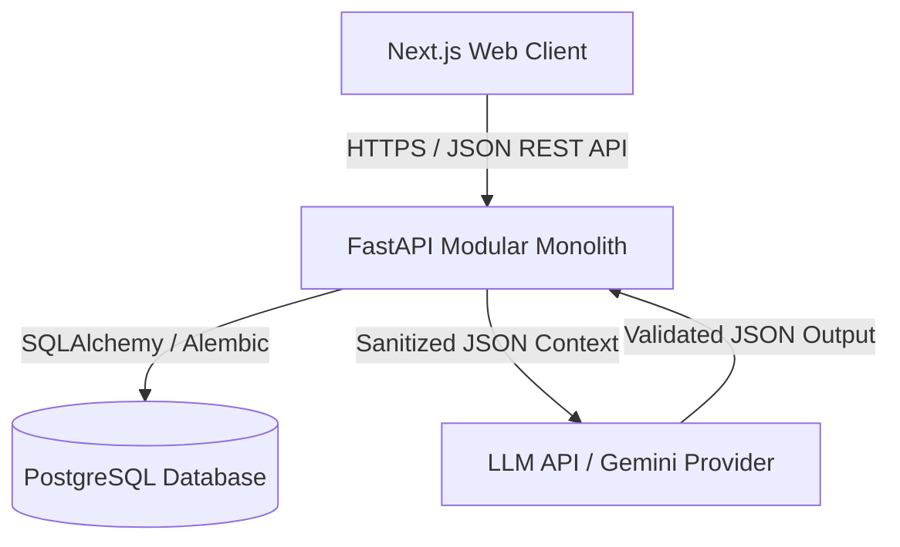

# VYORA — Software Requirements Specification (SRS)
**Smart Performance Management & Employee Development Intelligence Platform**

---

## 1. Introduction

### 1.1 Purpose
This Software Requirements Specification (SRS) establishes the formal functional, non-functional, security, and algorithmic requirements for **VYORA** (Version 1.0.0-MVP). It serves as the authoritative technical contract for software architects, backend engineers, frontend developers, QA test automation suites, and system evaluators.

### 1.2 Scope
VYORA is an AI-assisted web application engineered for Small and Medium-Sized Businesses (SMBs) to conduct evidence-based, continuous, and workload-aware employee performance evaluations linked directly to collaborative development planning. 
The system encompasses user directory management, goal and task tracking, deterministic KPI scoring, hybrid missing-data handling, qualitative manager/employee feedback, privacy-preserving AI narrative insights, collaborative development plans, and immutable historical review archives.

### 1.3 Definitions, Acronyms, and Abbreviations
- **AI:** Artificial Intelligence (specifically Large Language Model API services utilized for contextual narrative synthesis).
- **CSV:** Comma-Separated Values.
- **ERD:** Entity-Relationship Diagram.
- **KPI:** Key Performance Indicator.
- **LLM:** Large Language Model.
- **MVP:** Minimum Viable Product.
- **N/A:** Not Available.
- **PII:** Personally Identifiable Information.
- **RBAC:** Role-Based Access Control.
- **SMB:** Small and Medium-Sized Business.
- **SRS:** Software Requirements Specification.
- **UI/UX:** User Interface / User Experience.

---

## 2. Overall Description

### 2.1 Product Perspective
VYORA operates as an independent, cloud-deployable web application structured as a modular monolith. It consists of a Single-Page Application (SPA) frontend built with Next.js/React and a high-performance RESTful API backend engineered in Python (FastAPI), backed by a PostgreSQL relational database. Third-party LLM providers (e.g., Google Gemini API via official SDK) provide qualitative intelligence through an isolated, anonymized backend proxy.

### 2.2 User Classes and Characteristics
1. **Employee:** End-users being evaluated. Technical literacy varies from basic to high. Requires clear visual breakdowns, objective feedback, and transparent scoring.
2. **Manager / Team Leader:** Supervisory personnel evaluating direct reports. Needs team-level visibility, workload heatmaps, evidence synthesis, and efficient review workflows.
3. **Human Resources (HR):** Administrative specialists managing organizational structures, KPI configurations, review periods, and organization-wide analytics.
4. **System Administrator:** IT personnel overseeing security, system configuration, user provisioning, and audit logs.

### 2.3 Operating Environment
- **Server OS:** Linux (Ubuntu 22.04 LTS / Debian 12) or containerized Linux runtime.
- **Database Engine:** PostgreSQL 15+ with JSONB support.
- **Client Platforms:** Modern desktop and tablet web browsers (Google Chrome 110+, Mozilla Firefox 110+, Apple Safari 16+, Microsoft Edge 110+). Responsive layout designed for desktop resolutions (1280x720 and above).

### 2.4 Design and Implementation Constraints
- **CON-01 (Architecture):** The system must be built as a modular monolith. Distributed microservices and container orchestration (Kubernetes) are prohibited in MVP.
- **CON-02 (Database):** Primary persistence must be PostgreSQL via SQLAlchemy ORM. Migrations must be managed via Alembic.
- **CON-03 (Scoring Engine):** The scoring engine must be 100% deterministic and run on the backend. The LLM is strictly prohibited from computing scores or modifying database state directly.
- **CON-04 (Privacy):** No unmasked PII (names, emails, direct IDs) or internal credentials may be transmitted to external LLM APIs.

---

## 3. Business Rules (BR)

- **BR-001 (Evaluation Boundary):** Performance reviews are conducted on a per-employee, per-review-period basis. A review period defaults to one calendar month.
- **BR-002 (Organizational Scope):** An employee must belong to exactly one Department and hold exactly one Job Role (Designation) at any given time.
- **BR-003 (Goal Ownership & Approval):** Goals can be created by a Manager or an Employee. Employee-created goals remain in `PENDING_APPROVAL` status until explicitly approved or rejected by their assigned Manager.
- **BR-004 (Task Association):** Tasks may be linked to an existing Goal or exist as independent operational tasks (`goal_id` is nullable).
- **BR-005 (Scoring Authority):** The official performance score is determined strictly by backend mathematical algorithms using role-specific KPI templates. Finalized weights require stakeholder approval (`[NOT FINALIZED — REQUIRES VALIDATION AND APPROVAL]`).
- **BR-006 (Workload Contextuality):** Task complexity (Low, Medium, High) provides contextual interpretation of workload and difficulty. It must NOT act as an arbitrary numerical multiplier or direct penalty/bonus on performance scores.
- **BR-007 (Data Absence & Insufficiency):** Missing KPI data must never be defaulted to zero. If evidence is below the required threshold, the KPI must be marked `Not Available`. If the overall review evidence coverage is insufficient (<50%), the review must be assigned an `INSUFFICIENT_DATA` state.
- **BR-008 (Review Immutability):** Once a performance review is transitioned to `FINALIZED` status, an immutable snapshot of all metrics, weights, scores, narrative summaries, and evidence counts must be stored. Subsequent modifications to live tasks, goals, or role KPI templates must not alter finalized records.
- **BR-009 (AI Role & Guardrails):** AI is an advisory intelligence layer. AI outputs are non-binding drafts. AI is strictly prohibited from executing or recommending termination, promotion, salary adjustments, or disciplinary actions.
- **BR-010 (Development Plan Bilateral Agreement):** An official Development Plan requires mutual agreement: the plan becomes active only after both Manager and Employee have recorded their agreement.

---

## 4. Functional Requirements (FR)

### 4.1 Module 1: Authentication & Access Control
- **FR-001:** The system shall authenticate users via email and cryptographically hashed passwords using Argon2 or bcrypt.
- **FR-002:** The system shall issue stateless JSON Web Tokens (JWT) containing user ID, role, and department context with configurable expiration (default: 60 minutes) and refresh token rotation.
- **FR-003:** The system shall enforce strict Role-Based Access Control (RBAC) ensuring:
  - Employees only access their own records.
  - Managers only access employees within their assigned reporting line or department.
  - HR users access organization-wide personnel data and KPI configurations.
  - System Administrators manage accounts and system settings, with zero access to sensitive employee review narratives unless explicitly granted an audit role.
- **FR-004:** The system shall provide secure password reset functionality via time-limited, single-use cryptographic tokens.

### 4.2 Module 2: Organizational & Employee Directory
- **FR-005:** The system shall allow HR users to create, view, update, and soft-delete Departments and Job Roles.
- **FR-006:** The system shall allow HR users to manually create employee records, specifying name, email, department, job role, and designated manager.
- **FR-007:** The system shall allow HR users to upload employee records in bulk via CSV or Excel (.xlsx) files.
- **FR-008:** The system shall validate bulk import files row-by-row, validating schema compliance, required fields, foreign key existence, and duplicate emails before executing database commits.
- **FR-009:** The system shall record import batches with detailed error logs for each failed row without rolling back valid rows (partial commit with error ledger).

### 4.3 Module 3: Goal Management
- **FR-010:** The system shall allow Managers to create and assign goals to their direct reports.
- **FR-011:** The system shall allow Employees to create self-proposed goals.
- **FR-012:** The system shall transition employee-proposed goals to `PENDING_APPROVAL` status and alert the assigned manager.
- **FR-013:** The system shall allow Managers to approve or reject proposed goals with mandatory comments on rejection.
- **FR-014:** The system shall allow users to track goal progress through numeric target values, current values, milestone statuses (`ACTIVE`, `COMPLETED`, `CANCELLED`), and due dates.
- **FR-015:** The system shall calculate goal progress percentage as:
  $$\text{Progress \%} = \min\left(100, \max\left(0, \frac{\text{Current Value} - \text{Start Value}}{\text{Target Value} - \text{Start Value}} \times 100\right)\right)$$

### 4.4 Module 4: Task Management
- **FR-016:** The system shall allow Managers and Employees to create tasks with title, description, priority (`LOW`, `MEDIUM`, `HIGH`, `URGENT`), complexity (`LOW`, `MEDIUM`, `HIGH`), due date, and optional `goal_id`.
- **FR-017:** The system shall track task lifecycle states: `TODO`, `IN_PROGRESS`, `BLOCKED`, `COMPLETED`, `CANCELLED`.
- **FR-018:** The system shall require a mandatory text explanation whenever a task is marked `BLOCKED`.
- **FR-019:** The system shall record timestamps for task creation, status transitions, and final completion.
- **FR-020:** The system shall track if a task is reopened after completion (`is_reopened` boolean) and log the event in audit history.

### 4.5 Module 5: KPI & Performance Scoring Engine
- **FR-021:** The system shall maintain a centralized catalog of KPI definitions categorized into `TASK`, `GOAL`, `QUALITY`, `CONSISTENCY`, and `DEADLINE`.
- **FR-022:** The system shall allow HR users to configure role-specific KPI templates, assigning default weights and minimum evidence thresholds per job role.
- **FR-023:** The system shall deterministically calculate raw KPI metrics for a specified employee and review period:
  - Task Completion Rate: Completed Tasks / Total Scheduled Tasks.
  - Goal Achievement Rate: Average progress percentage across active period goals.
  - On-Time Completion Rate: Tasks completed on or before `due_date` / Total completed tasks.
  - Quality Indicator: Role-appropriate rating derived from manager quality assessment or defect rate.
  - Consistency Metric: Variance of task completion velocity over the period.
- **FR-024:** The system shall normalize raw metric values to a standard 0–100 scale using bounded linear normalization.
- **FR-025:** The system shall audit data evidence counts for each KPI against the configured `min_evidence_threshold`.
- **FR-026:** The system shall mark KPIs failing the evidence threshold as `Not Available` (N/A) and calculate overall Data Coverage Percentage:
  $$\text{Data Coverage \%} = \frac{\sum \text{Eligible Metric Weights with Valid Evidence}}{\text{Total Configured Weights}} \times 100$$
- **FR-027:** If Data Coverage is $\ge 50\%$, the system shall compute the normalized composite score by redistributing weights proportionally across eligible metrics:
  $$\text{Final Score} = \sum_{i \in \text{Valid Metrics}} \left( \text{Normalized Score}_i \times \frac{\text{Weight}_i}{\sum_{j \in \text{Valid Metrics}} \text{Weight}_j} \right)$$
- **FR-028:** If Data Coverage is $< 50\%$, the system shall assign the review an `INSUFFICIENT_DATA` score status and suppress numerical composite score generation.

### 4.6 Module 6: Workload Context Engine
- **FR-029:** The system shall compute an employee's active workload context based on concurrent active tasks, complexity distribution, and overdue count.
- **FR-030:** The system shall surface workload indicators (`NORMAL`, `HIGH_WORKLOAD`, `OVERLOADED`) as contextual badges in the UI and data bundles sent to the AI layer.
- **FR-031:** The system shall enforce that workload indicators do NOT directly apply mathematical deductions or bonuses to the calculated performance score.

### 4.7 Module 7: Feedback & Qualitative Self-Assessment
- **FR-032:** The system shall provide a monthly Self-Assessment workflow allowing employees to submit qualitative reflections on accomplishments, roadblocks, and self-evaluated growth.
- **FR-033:** The system shall provide a Manager Feedback workflow to record structured qualitative feedback, observed strengths, and recommended focus areas.
- **FR-034:** The system shall ensure manager feedback and self-assessments are linked to the specific Review Period.

### 4.8 Module 8: AI Performance Intelligence & Explanation
- **FR-035:** The system shall assemble an anonymized context bundle comprising aggregated KPI values, data coverage %, goal progress summaries, task completion/delay stats, workload context, and qualitative feedback text.
- **FR-036:** The system shall strip direct PII (employee names, email addresses, personal identification numbers) from the context bundle, replacing them with ephemeral pseudonymous tokens (e.g., `SUBJECT_A`).
- **FR-037:** The system shall transmit the sanitized context to the backend AI service requesting structured JSON conforming strictly to the `AIInsightOutputSchema`.
- **FR-038:** The system shall validate LLM responses against the strict Pydantic JSON schema. If parsing fails, the system shall execute one automatic retry with temperature 0.0 before throwing a managed fallback exception.
- **FR-039:** The system shall verify that all claims in the AI output reference valid metric identifiers present in the context bundle (`evidence_references`).
- **FR-040:** The system shall allow Employees and Managers to flag any AI insight as inaccurate or biased, recording a mandatory explanation in `ai_insights.flag_reason`.

### 4.9 Module 9: Performance Review & Finalization Workflow
- **FR-041:** The system shall generate a monthly draft Performance Review for each active employee upon review period closing.
- **FR-042:** The system shall allow the assigned Manager to inspect the calculated score breakdown, evidence coverage, self-assessment, and AI-generated narrative draft.
- **FR-043:** The system shall allow the Manager to record a formal review summary and finalize the review.
- **FR-044:** Upon finalization, the system shall transition status to `FINALIZED`, set `finalized_at`, and create an immutable record in `review_metric_snapshots` capturing every KPI value, applied weight, normalization formula version, and evidence count.
- **FR-045:** The system shall lock finalized reviews against any automatic re-calculation or modification by subsequent task/goal updates.

### 4.10 Module 10: Collaborative Development Plans
- **FR-046:** The system shall allow Managers, assisted by AI recommendations, to create structured Development Plans comprising objective, timeline, target skills, and concrete action items.
- **FR-047:** The system shall allow Employees to review proposed development plans, suggest edits, and record digital agreement.
- **FR-048:** The system shall activate the plan only when both `employee_agreed` and `manager_agreed` flags are `TRUE`.
- **FR-049:** The system shall track completion status for individual action items within an active Development Plan.

### 4.11 Module 11: Dashboards & Analytics
- **FR-050:** The system shall provide an Employee Dashboard displaying current period tasks, goal progress meters, historical review scores, workload status, and active development action items.
- **FR-051:** The system shall provide a Manager Dashboard displaying team roster, review completion progress, workload distribution across team members, and pending goal approval requests.
- **FR-052:** The system shall provide an HR Dashboard displaying company-wide score distributions, departmental completion rates, data coverage audits, and aggregate skill growth indicators.

---

## 5. Non-Functional Requirements (NFR)

### 5.1 Performance Requirements
- **NFR-001 (API Latency):** 95% of standard read/write REST API requests shall respond within 250 milliseconds under a nominal load of 100 concurrent SMB users.
- **NFR-002 (Scoring Computation):** Deterministic performance score calculations for an individual employee shall execute in less than 50 milliseconds.
- **NFR-003 (AI Synthesis Time):** AI insight generation pipeline (data assembly, pseudonymization, LLM roundtrip, schema validation) shall complete within 6 seconds.
- **NFR-004 (Batch Imports):** Bulk CSV/Excel employee imports shall process at a minimum rate of 200 employee rows per second with full database validation.

### 5.2 Reliability & Availability
- **NFR-005 (Uptime):** The application shall achieve 99.9% uptime during standard business operating hours (07:00 to 20:00 local time).
- **NFR-006 (Fault Isolation):** Failure or timeout of the external LLM provider shall NOT disrupt core application workflows (task tracking, goal editing, score calculation, or review finalization). The system shall display deterministic scores with an advisory notice that AI narrative generation is temporarily delayed.
- **NFR-007 (Data Persistence):** Database transactions must adhere strictly to ACID properties. Every finalized review snapshot transaction must be atomic.

### 5.3 Security & Privacy Requirements
- **NFR-008 (Cryptographic Storage):** User passwords must be hashed using Argon2id or bcrypt with high work factor (salt >= 16 bytes, bcrypt cost >= 12).
- **NFR-009 (Transport Encryption):** All network communication between client, backend, and external AI services must enforce TLS 1.3 encryption.
- **NFR-010 (RBAC Enforcement):** Every backend API route must validate JWT signature, token revocation status, and role/tenant permissions before database access.
- **NFR-011 (SQL Injection Prevention):** All database interactions must use parameterized queries exclusively through SQLAlchemy ORM. Raw string-concatenated SQL queries are strictly prohibited.
- **NFR-012 (XSS & Injection Protection):** All user-provided strings (descriptions, feedback, comments) must be sanitized and rendered securely by React's virtual DOM.
- **NFR-013 (Audit Trail):** Security-sensitive events (authentication failures, role modifications, review finalizations, and bulk data imports) must be logged to an append-only `audit_logs` table.

### 5.4 Usability & Accessibility
- **NFR-014 (Clarity & Cognitive Load):** The UI must display explicit explanations, evidence counts, and formulas alongside every numerical score.
- **NFR-015 (Responsive Design):** The web application must render seamlessly across desktop and laptop display resolutions (1280x720 up to 2560x1440).
- **NFR-016 (Accessibility Standards):** The user interface shall comply with WCAG 2.1 Level AA standards for color contrast, keyboard navigability, and screen reader compatibility.

---

## 6. Use Cases (UC)

### 6.1 UC-001: Monthly Review Finalization with Evidence Snapshot
- **Primary Actor:** Manager.
- **Preconditions:** Review period has reached its end date; Employee has submitted monthly self-assessment; Tasks and goals have been updated.
- **Main Flow:**
  1. Manager navigates to Team Reviews and selects an employee.
  2. System executes deterministic scoring engine and displays raw metrics, normalized scores, applied weights, and evidence counts.
  3. System displays data coverage percentage (e.g., 85%).
  4. Manager inspects employee self-assessment, task outcomes, and AI-synthesized narrative draft.
  5. Manager enters formal review summary comments and clicks "Finalize Review".
  6. System validates authorization and initiates a single database transaction.
  7. System sets review status to `FINALIZED` and inserts detailed metric snapshots into `review_metric_snapshots`.
  8. System locks review from future recalculation and emits notification to Employee.
- **Postconditions:** Review record is immutable; Historical snapshot is permanently stored.

### 6.2 UC-002: Collaborative Development Plan Agreement
- **Primary Actors:** Manager and Employee.
- **Preconditions:** Performance Review is finalized or under active evaluation.
- **Main Flow:**
  1. Manager accesses Development Planning tab and reviews AI-suggested skill recommendations.
  2. Manager crafts a development plan containing 3 actionable milestones and sets target dates.
  3. Manager clicks "Submit Plan to Employee". Plan status changes to `PROPOSED`.
  4. Employee receives notification, logs in, reviews plan details, and enters feedback/agreement.
  5. Employee checks "I Agree to this Development Plan".
  6. Manager registers their concurrence.
  7. When both agreement flags evaluate to `TRUE`, the system transitions status to `IN_PROGRESS`.
- **Postconditions:** Active development plan is established and milestone progress is tracked on employee dashboard.

### 6.3 UC-003: Insufficient Evidence Handling
- **Primary Actor:** Employee / Manager.
- **Preconditions:** Employee joined midway through review period or logged fewer than minimum task thresholds.
- **Main Flow:**
  1. System triggers scoring calculation for the review period.
  2. Scoring engine assesses evidence counts for all role KPIs.
  3. Evidence count for Quality is 0 (threshold = 3), Deadline count is 1 (threshold = 5). Both KPIs marked `Not Available`.
  4. Aggregate eligible weight yields Data Coverage of 40% (< 50% threshold).
  5. System sets review score status to `INSUFFICIENT_DATA` and suppresses composite numerical score.
  6. UI presents an informational state: "Insufficient Data for Composite Score (Coverage: 40%). Manager qualitative review required."
- **Postconditions:** Employee is not penalized with a false low score or zero.

---
*End of Software Requirements Specification.*
