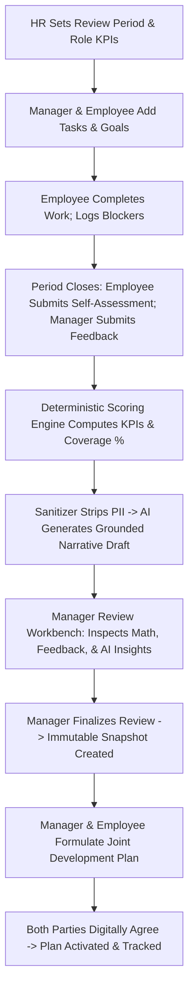

# VYORA — Comprehensive Project Summary & Master Context Document
**Smart Performance Management & Employee Development Intelligence Platform**

---

## 1. Project Identity
- **Working Project Name:** VYORA *(Working project name; not yet trademark/domain verified. No trademark or availability claims are made).*
- **Full Project Name:** Smart Performance Management & Employee Development Intelligence Platform
- **Product Domain:** HR Tech / People Analytics / Performance Intelligence & Employee Growth
- **Product Type:** AI-assisted, web-based employee performance evaluation, contextual workload analytics, and personalized development platform.
- **Target Market:** Small and Medium-Sized Businesses (SMBs) with 20 to 500 knowledge and service workers.

---

## 2. Project Vision
> *"Don't just measure employee performance. Understand it, explain it, identify risks early, and help people improve."*

Traditional performance management relies on backward-looking, subjective annual reviews where managers assign arbitrary scores without verifiable data. VYORA transforms this paradigm into a continuous, evidence-grounded, workload-aware, and explainable feedback loop. The platform prioritizes employee development, psychological safety, transparency, and actionable coaching over employee surveillance or punitive appraisal.

---

## 3. Core Problem
Small and Medium-Sized Businesses suffer from systemic issues in traditional performance evaluation:
1. **Infrequent & Delayed Reviews:** Annual or quarterly appraisals provide feedback months after work is done, when context has been forgotten.
2. **Subjective & Biased Ratings:** Evaluations are heavily distorted by recency bias, personal affinity, and halo/horns effects.
3. **Over-Reliance on Simplistic Scores:** Flattening human contribution into an arbitrary number (e.g., "3.8/5") obscures specific strengths and bottlenecks.
4. **Task-Count Distortion:** Rewarding raw volume penalizes workers tackling difficult, high-complexity, or multi-week initiatives.
5. **Ignoring Workload & Blockers:** High workload and third-party dependencies frequently cause delivery delays, yet traditional tools unfairly penalize the worker without context.
6. **Disconnected Work Artifacts:** Daily tasks, quarterly strategic goals, and feedback notes live in siloed tools.
7. **Opaque Scoring Formulas:** Employees receive finalized ratings without visibility into the underlying math, criteria, or evidence.
8. **Lack of Actionable Improvement:** Evaluations rarely translate into structured growth, skill coaching, or concrete training paths.
9. **Unfair Handling of Missing Data:** Missing inputs are either arbitrarily penalized as zeroes or ignored, corrupting organizational analytics.

---

## 4. Proposed Solution
VYORA delivers a unified platform combining:
- **Deterministic Analytics:** 100% backend-calculated metrics (Task Completion, Goal Progress, On-Time Delivery, Quality, Consistency).
- **Workload & Complexity Context:** Displays concurrent tasks and complexity indicators alongside metrics without arbitrary numerical score distortions.
- **Hybrid Data Coverage Audit:** Audits evidence counts against minimum thresholds. Marks unmeasured KPIs as `Not Available` and triggers an `INSUFFICIENT_DATA` state if coverage falls below 50%, preventing false penalties.
- **Privacy-Preserving AI Explanations:** Anonymizes employee data and utilizes Large Language Models to generate structured, evidence-grounded narrative summaries, strengths, improvement areas, and coaching suggestions.
- **Collaborative Development Plans:** Bilateral action plans requiring digital agreement from both Employee and Manager before activation.
- **Immutable Historical Snapshots:** Freezes full configuration, applied weights, raw metrics, evidence counts, and narrative summaries upon review finalization to guarantee historical integrity.

---

## 5. Unique Value Proposition
| Dimension | Traditional Tools / Spreadsheets | VYORA Intelligence Platform |
| :--- | :--- | :--- |
| **Scoring Authority** | Subjective manager intuition | Deterministic mathematical algorithms with full formula transparency |
| **Workload Sensitivity** | Ignored or treated as output volume | Contextual factor preventing unfair penalization |
| **Missing Data Policy** | Penalized as zero or ignored | Hybrid coverage audit: marked N/A; composite score suppressed if coverage <50% |
| **Role Nuance** | Generic global forms | Role-specific KPI templates tailored to job functions |
| **AI Integration** | None or ungrounded auto-complete | Strictly grounded, schema-validated narrative citing specific evidence |
| **Growth Linkage** | Disconnected or non-existent | Direct bilateral development action plans with milestone tracking |
| **Surveillance Policy** | Intrusive activity tracking common | Strictly outcome- and evidence-based; zero surveillance |

---

## 6. Target Users & Personas
- **Primary Market:** SMBs (20 to 500 employees) across technology, design, professional services, and knowledge work.
- **Persona 1: The Knowledge Worker (Employee):** Needs transparency, fair recognition of difficult tasks, visible evidence, and clear growth pathways.
- **Persona 2: The Team Leader (Manager):** Needs clear visibility into team workload, early warning of blocked tasks, objective metrics to guide reviews, and coaching support.
- **Persona 3: The People Operations Lead (HR):** Needs standardized evaluation criteria across departments, automated review period orchestration, and organization-wide skill growth trends.
- **Persona 4: The IT Administrator (Admin):** Needs tenant configuration, user provisioning, security controls, and auditability with zero access to sensitive employee review narratives.

---

## 7. User Roles & Permissions Boundaries
1. **Employee:**
   - View profile, assigned goals, and role-specific KPIs.
   - Create personal goals (subject to manager approval) and self-managed tasks.
   - Track monthly score breakdowns, evidence counts, and workload context.
   - Submit monthly self-assessments.
   - Review AI narrative explanations; flag inaccurate insights.
   - Review, edit, and digitally agree to Development Plans.
2. **Manager / Team Leader:**
   - Manage direct reports within assigned team/departmental boundary.
   - Assign goals and review/approve employee-initiated goals.
   - Assign tasks, track progress, review blockers, and submit qualitative feedback.
   - Conduct monthly reviews, inspect deterministic score previews, and finalize reviews.
   - Draft and approve collaborative Development Plans.
3. **Human Resources (HR):**
   - Manage departments, job roles, and organizational assignments.
   - Onboard employees manually and via batch CSV/Excel import.
   - Configure review periods (calendar months) and role-specific KPI templates.
   - Review company-wide score distributions, departmental trends, and data coverage audits.
4. **System Administrator:**
   - Manage user accounts, authentication policies, and system settings.
   - Monitor technical system health, background jobs, and error logs.
   - Inspect immutable security audit logs (`audit_logs`).
   - *Boundary Rule:* System Administrators have NO automatic access to view or modify sensitive employee review narratives or evaluation scores.

---

## 8. End-to-End Workflow

---

## 9. Core Features (MVP Catalog)
- **FT-A01..A06 (Directory & Access):** JWT authentication, RBAC guards, department/role setup, manual employee creation, and batch CSV/Excel import with error reporting.
- **FT-B01..B05 (Goal Management):** Manager-assigned and employee-created goals, manager approval workflow, and measurable progress tracking.
- **FT-C01..C06 (Task Management):** Task lifecycle (`TODO` to `COMPLETED`), priority, complexity tagging, mandatory blocker logging, and optional goal linking (`goal_id` nullable).
- **FT-D01..D07 (Scoring & Analytics):** Role-specific KPI templates, bounded linear normalization, evidence threshold auditing, hybrid weight redistribution, and `INSUFFICIENT_DATA` state handling.
- **FT-E01..E03 (Workload Context):** Active task counts and complexity distribution displayed as contextual indicators without direct score distortion.
- **FT-F01..F03 (Qualitative Feedback):** Structured manager feedback and employee self-assessments linked to review periods.
- **FT-G01..G07 (AI Intelligence):** PII anonymization, structured JSON output (`AIInsightOutputSchema`), evidence citation verification, strengths/growth extraction, and user insight flagging.
- **FT-H01..H06 (Reviews & Snapshots):** Monthly review workbench, manager finalization remarks, and immutable historical snapshot freezing in `review_metric_snapshots`.
- **FT-I01..I04 (Collaborative Development):** AI-assisted plan drafting, bilateral digital agreement, and milestone action item tracking.
- **FT-J01..J04 (Dashboards & Governance):** Dedicated dashboards for all 4 roles, trend charts, and security audit logs (`audit_logs`).

---

## 10. MVP Scope Boundaries
- **In-Scope:** SMB-tailored performance intelligence, continuous task/goal tracking, monthly formal reviews, deterministic scoring, workload context, qualitative feedback, privacy-preserving AI explanations, bilateral development plans, and CSV onboarding.
- **Implementation Targets:** Production-oriented modular monolith deployed on a single cloud VM or containerized PaaS with managed PostgreSQL.

---

## 11. Out-of-Scope & Explicitly Excluded Features
To prevent scope creep, the following are **strictly excluded**:
- **Payroll & Compensation:** No salary management, bonus computations, or compensation changes.
- **Time & Attendance Tracking:** No clock-in/out, biometric tracking, timesheets, or leave/vacation management.
- **Recruitment & Applicant Tracking (ATS):** No job postings, candidate pipelines, resume parsing, or interview scheduling.
- **Full Learning Management System (LMS):** No hosting of video courses or SCORM grading engines (skill suggestions and resource links only).
- **Employee Surveillance:** No keystroke logging, webcam monitoring, desktop screenshot capture, or intrusive background tracking.
- **360-Degree / Peer Feedback:** Peer reviews and external client ratings are deferred.
- **Autonomous Employment Decisions:** AI is strictly prohibited from making or recommending hiring, firing, promotion, salary, or disciplinary actions.
- **Complex External Integrations:** No live two-way sync with Jira, GitHub, Slack, or HRIS platforms in initial MVP (CSV/Excel only).
- **Distributed Microservices Infrastructure:** No Kubernetes, Kafka, or distributed multi-database architecture.

---

## 12. Database & Domain Model Summary
- **Database Engine:** PostgreSQL 15+ using SQLAlchemy ORM and Alembic migrations.
- **Core Entities (15 Tables):**
  1. `departments` — Business units (e.g., Engineering, Sales).
  2. `job_roles` — Professional designations mapping to departments.
  3. `users` — Authentication, profile, RBAC role, and reporting line.
  4. `review_periods` — Monthly evaluation cycles (e.g., "2026-11").
  5. `goals` — Strategic objectives with dual-origin creation and approval workflow.
  6. `tasks` — Operational evidence with complexity, blockers, and optional `goal_id`.
  7. `kpi_definitions` — Standard catalog of performance metrics.
  8. `role_kpi_configs` — Role-specific KPI templates, weights, and thresholds.
  9. `feedbacks` — Manager feedback and employee self-assessments.
  10. `performance_reviews` — Formal monthly evaluation records per employee.
  11. `review_metric_snapshots` — Immutable snapshot table freezing finalized review data.
  12. `ai_insights` — Validated structured AI narrative and coaching outputs.
  13. `development_plans` — Bilateral growth plans requiring mutual digital agreement.
  14. `import_batches` — Ledger for bulk employee onboarding runs.
  15. `audit_logs` — Immutable administrative and security audit trail.

---

## 13. Performance Scoring Summary
- **Scoring Framework:** Combines Task Completion, Goal Progress, On-Time Delivery, Quality, and Consistency.
- **Deterministic Calculation:** Official scores are 100% computed by backend algorithms. The LLM never calculates scores.
- **Scoring Weights:** `[NOT FINALIZED — REQUIRES VALIDATION AND APPROVAL]`. Illustrated weights (Goal 30%, Task 25%, Deadline 20%, Quality 15%, Consistency 10%) are unapproved baseline proposals.
- **Task Complexity:** Contextual only (PS-4). Does NOT act as an arbitrary numerical multiplier or direct penalty/bonus.
- **Deadline Scoring:** `[PROPOSED — REQUIRES APPROVAL]`. Proposed: Blocker-aware on-time delivery rate with grace period.
- **Quality Metrics:** `[PROPOSED — REQUIRES APPROVAL]`. Role-appropriate measurements (defect rate for devs, satisfaction for support).
- **Hybrid Missing Data Policy (PS-7):** Missing data != 0. Metrics failing evidence thresholds are marked `Not Available`. Coverage >= 50% triggers proportional weight redistribution. Coverage < 50% triggers `INSUFFICIENT_DATA` state and suppresses composite numerical score.
- **Cadence (PS-8):** Monthly formal review finalizations with continuous underlying operational analytics.

---

## 14. AI System & Governance Summary
- **AI Capabilities:** Explains scores, summarizes feedback, extracts strengths and improvement areas, suggests training resources, drafts development plans, and provides contextual interpretation.
- **Input Data Minimization:** Context bundles contain aggregated metrics, goals, tasks, blocker summaries, and qualitative feedback. Names, emails, and direct UUIDs are replaced with ephemeral pseudonyms (`SUBJECT_A`). Passwords, tokens, and unrelated data are never sent.
- **Prompt Injection Defense:** User-supplied text is treated as untrusted input and isolated inside strictly delimited XML blocks. Temperature is locked to 0.1.
- **Structured Output Contract:** Responses must conform strictly to `AIInsightOutputSchema`.
- **Grounding Verification:** Every generated claim must cite valid metric codes (`evidence_references`). Hallucinations are flagged by the backend.
- **User Dispute Controls:** Users can flag inaccurate AI insights with a mandatory explanation.
- **Non-Negotiable Prohibitions:** AI cannot calculate scores, recommend firing, hiring, promotions, salary changes, or disciplinary actions, diagnose psychological traits, or modify database records autonomously.

---

## 15. System Architecture Summary
- **Pattern:** Modular Monolith in a single Git repository.
- **Frontend:** Next.js 14+ (App Router), React 18+, TypeScript (strict mode), Tailwind CSS, shadcn/ui, Recharts.
- **Backend:** Python 3.11+, FastAPI, Pydantic v2, SQLAlchemy 2.0, Alembic, Uvicorn.
- **Analytics:** Pure Python deterministic scoring modules.
- **AI Integration:** Google Gemini API accessed via backend proxy with PII anonymization.
- **Database:** PostgreSQL 15+ relational database.
- **Deployment:** Cost-conscious single-node cloud VM or containerized PaaS (Render / Railway / Cloud Run) with Nginx reverse proxy. Zero Kubernetes or message queue sprawl.

---

## 16. Security, Privacy & Fairness
- **Authentication:** Argon2id password hashing + 60-minute JWT access tokens + rotating `HttpOnly; SameSite=Strict` refresh tokens.
- **RBAC:** Strict boundary enforcement across Employee, Manager, HR, and Admin. Admin has no automatic access to review narratives.
- **Injection Defense:** 100% parameterized SQLAlchemy queries (no raw SQL strings) + React virtual DOM XSS escaping.
- **Rate Limiting:** Token-bucket rate limiting on auth and AI endpoints via `slowapi`.
- **Fairness Protection:** Insufficient data alerts, transparent formula breakdowns, and context badges (workload/blockers) visible alongside all scores.

---

## 17. Consolidated Decision Register

### Approved Decisions `[APPROVED]`
- **DEC-DB-01:** Evaluation unit is per employee per review period.
- **DEC-DB-02:** Simple hierarchy (Department + Job Role); no complex matrix graph.
- **DEC-DB-03:** Dual goal creation (manager & employee) with approval flow.
- **DEC-DB-04:** Tasks optionally link to goals (`goal_id` nullable).
- **DEC-DB-05:** Feedback includes manager feedback and employee self-assessment only.
- **DEC-DB-06:** Lightweight formal review entity (`performance_reviews`).
- **DEC-DB-07:** Immutable snapshot table (`review_metric_snapshots`) frozen at finalization.
- **DEC-PS-01:** Scoring combines task completion, goals, quality, consistency, and deadlines.
- **DEC-PS-02:** Shared base scoring framework with role-specific KPI templates.
- **DEC-PS-04:** Task complexity is contextual only; no direct score modification.
- **DEC-PS-07:** Hybrid missing data handling (N/A marking, weight redistribution, `INSUFFICIENT_DATA`).
- **DEC-PS-08:** Monthly formal reviews with continuous underlying analytics.
- **DEC-AI-01:** AI explains scores, summarizes feedback, extracts strengths, drafts plans.
- **DEC-AI-02:** LLM receives minimized, aggregated metrics and feedback.
- **DEC-AI-03:** PII is pseudonymized (`SUBJECT_A`) before LLM API calls.
- **DEC-AI-04:** Project claims must cite verified evidence references; no hallucinations.
- **DEC-AI-05:** Structured JSON output matching Pydantic schema is mandatory.
- **DEC-AI-06:** Development plans require bilateral digital agreement from both parties.
- **DEC-AI-07:** AI strictly prohibited from making employment decisions or scoring.
- **DEC-AI-08:** Users can flag inaccurate AI insights with mandatory reasons.
- **DEC-MVP-01..03:** Target SMBs, 4 roles, manual + CSV/Excel employee onboarding.
- **DEC-MVP-08:** Modular Monolith architecture; no microservices or Kubernetes.

### Proposed Decisions `[PROPOSED — REQUIRES APPROVAL]`
- **DEC-PS-03:** Proposed baseline scoring weights (Goal 30%, Task 25%, Deadline 20%, Quality 15%, Consistency 10%). `[NOT FINALIZED — REQUIRES VALIDATION AND APPROVAL]`.
- **DEC-PS-05:** Proposed blocker-aware deadline scoring algorithm with 24-hour grace window.
- **DEC-PS-06:** Proposed role-specific quality metrics (defect rate, review ratings, satisfaction).

### Deferred Decisions `[DEFERRED]`
- **DEC-MVP-07:** Live two-way integrations with Jira, GitHub, Slack, Teams, and HRIS platforms.
- **DEC-DB-05-EXT:** 360-degree peer feedback and external client reviews.
- **DEC-FE-MOB:** Native iOS/Android mobile applications.

### Rejected Scope `[REJECTED]`
- **DEC-MVP-04:** Payroll, salary calculation, biometric tracking, attendance, and leave management.
- **DEC-MVP-05:** Recruitment, applicant tracking (ATS), and candidate pipelines.
- **DEC-MVP-06:** Full LMS video course hosting and grading engines.
- **DEC-MVP-09:** Employee surveillance, keystroke monitoring, and desktop screen capture.

---

## 18. Current Implementation Status
- **Phase 0 (Foundation Architecture & Documentation):** **100% COMPLETE & VERIFIED**.
  - All 16 foundation specifications, SQL schema DDL, and ERD PNG created.
  - Cross-document consistency audit completed with zero contradictions.
- **Phase 1 through 7 (Implementation & Deployment):** **NOT STARTED / PLANNED**.
  - Implementation is scheduled to begin with backend scaffolding and database models.

---

## 19. Lean Development Principles for Developers & AI Agents
1. **Build Only What Validates Core Value:** Focus on evidence-based scoring, explainability, and development plans.
2. **Zero Scope Creep:** Never implement excluded modules (payroll, leave, ATS, LMS, peer review).
3. **No Unapproved Changes:** Never modify database tables, scoring formulas, or AI boundaries without explicit approval.
4. **Inspect Before Coding:** Inspect existing files before writing code. Never assume files are missing.
5. **Always Write & Run Tests:** 100% branch coverage required for scoring algorithms. Verify before claiming success.

---

## 20. Future Scope (Post-MVP Roadmap)
- Live webhook integrations with GitHub, GitLab, and Jira for automated task evidence syncing.
- Slack and Microsoft Teams notification bots for period reminders and goal approvals.
- Cascading organizational OKR tree visualizers for executive leadership.
- 360-degree peer feedback cycles with configurable anonymity settings.
- Advanced statistical cross-department evaluation bias audits.

---

## 21. Success Criteria & Evaluation Metrics
- **100% Scoring Transparency:** Every score displays underlying evidence counts and formula breakdowns.
- **Zero Missing Data Penalties:** Zero instances of missing metrics defaulting to zero scores.
- **AI Reliability & Grounding:** 100% of generated claims trace to verified evidence references; schema pass rate > 99%.
- **Actionable Development:** > 75% of finalized reviews lead to an active, mutually agreed Development Plan.
- **Rapid SMB Onboarding:** Onboarding a 50-person organization via CSV in under 15 minutes.
- **System Performance:** p95 API response times < 250ms; 99.9% uptime for core monolith.

---

## 22. Key Risks & Strategic Mitigations
| Risk Factor | Impact | Mitigation Strategy |
| :--- | :--- | :--- |
| **Manager Rating Inflation:** Managers assign uniform high scores without evidence. | High | System enforces role-specific KPI evidence checks and flags variance against self-assessments. |
| **AI Hallucinations:** LLM fabricates projects or attributes fictional behavior. | High | Strict PII-sanitized context bundles, temperature 0.1, and automated evidence citation verification. |
| **Employee Cynicism:** System perceived as surveillance or punishment tool. | High | Transparent UI showing exact evidence managers see; zero background monitoring; explicit focus on coaching. |
| **Sparse Data in Small Teams:** Infrequent task logging leads to insufficient data. | Medium | Hybrid scoring engine gracefully flags `INSUFFICIENT_DATA`, displays coverage rates, and instructs managers to conduct qualitative assessments. |

---
*End of Comprehensive Project Summary & Master Context Document.*
