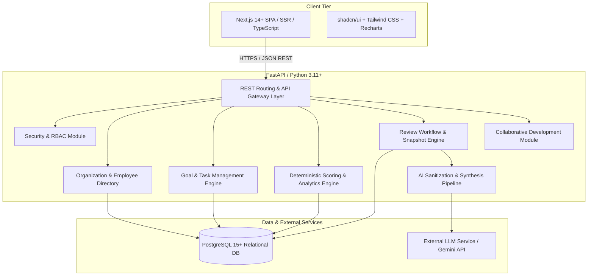
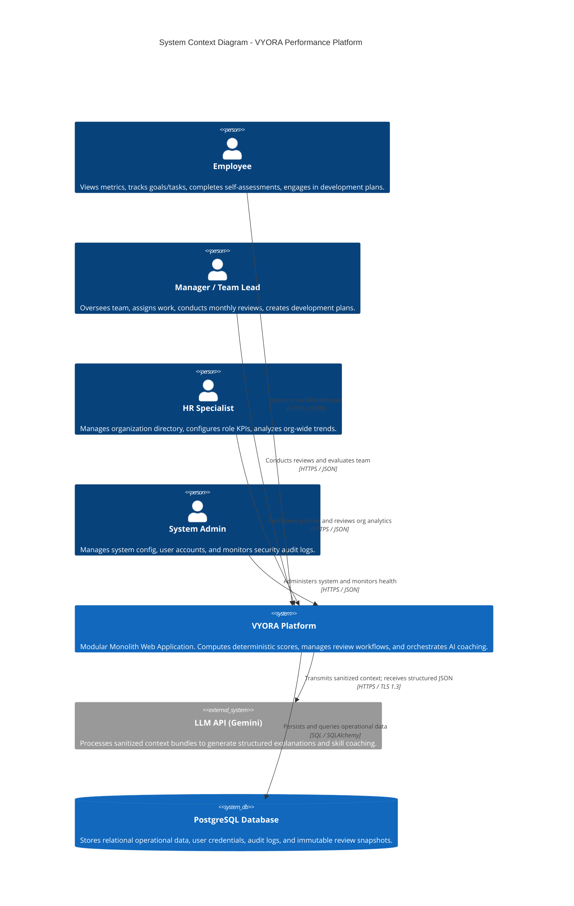
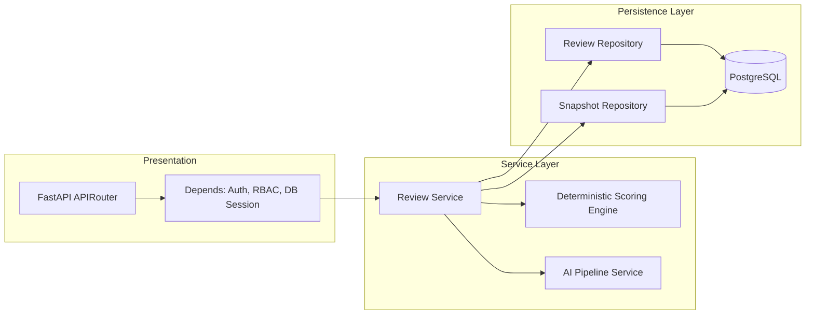
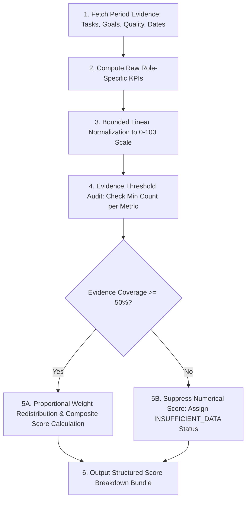
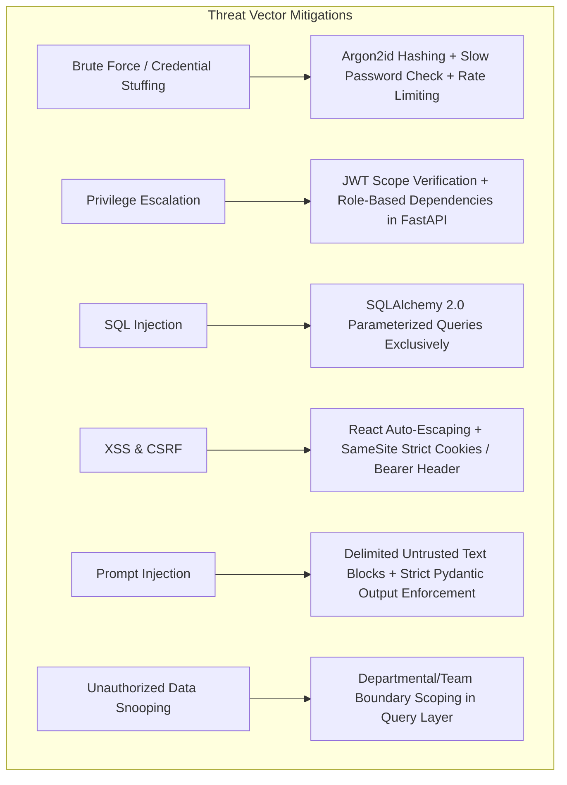
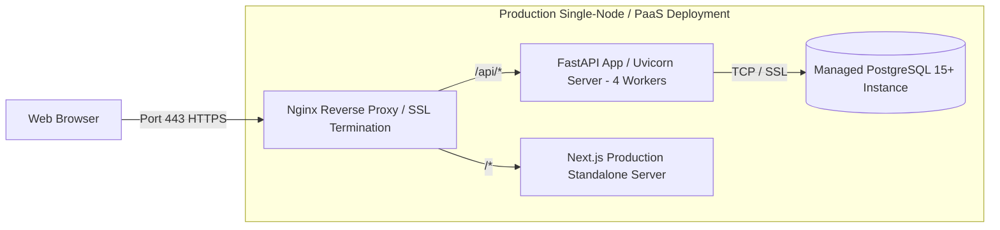

# VYORA — System Architecture Document
**Smart Performance Management & Employee Development Intelligence Platform**

---

## 1. Architectural Vision & Principles

### 1.1 Architectural Pattern: Modular Monolith
VYORA is architected as a **Modular Monolith**. 
For the target SMB market (20 to 500 users) and the production-oriented MVP phase, a modular monolith provides:
- Clean module boundaries with zero distributed network overhead.
- Direct in-memory inter-module communication with strict domain service interfaces.
- Transactional integrity via single-database ACID guarantees.
- Elimination of distributed systems complexities (no saga patterns, no message queues, no network partitions, no Kubernetes operational overhead).
- A frictionless deployment and local development experience suitable for lean engineering teams.



### 1.2 Core Architectural Principles
1. **Deterministic Authority vs. Advisory AI:** Math, scores, and metrics are computed 100% deterministically by Python backend modules. The LLM is an isolated qualitative interpretation layer that produces natural language summaries, explanations, and coaching drafts. AI never writes to official score fields or executes employment decisions.
2. **Immutable Historical Records:** Performance reviews are time-bound evaluations. When a review is marked `FINALIZED`, a complete snapshot of raw metrics, applied weights, normalization settings, and evidence counts is frozen in `review_metric_snapshots`. Changes to current tasks, goals, or role templates will never mutate historical snapshots.
3. **Data Minimization & AI Privacy Isolation:** The AI subsystem operates behind a strict anonymization proxy. Direct PII (names, emails, IDs) is stripped and replaced with ephemeral pseudonymous references before calling external LLM APIs.
4. **Resilient Hybrid Scoring:** Missing data is never treated as zero. If data coverage fails the minimum threshold (<50%), composite scores are suppressed, transitioning the review to an explicit `INSUFFICIENT_DATA` state.
5. **Strict Boundary Enforcement (RBAC):** Access control is verified at the API routing layer and reaffirmed at the service layer to prevent horizontal and vertical privilege escalation.

---

## 2. High-Level System Architecture

### 2.1 System Context (C4 Level 1)


---

## 3. Component Architecture & Module Responsibilities

### 3.1 Backend Modular Monolith (FastAPI)
The backend codebase is organized into discrete domain packages under `backend/app/modules/`. Modules communicate via strongly typed service interfaces and share the database session.

| Module | Core Responsibility | Internal Dependencies |
| :--- | :--- | :--- |
| **`auth`** | User authentication, password hashing, JWT issue/validation, RBAC middleware. | None |
| **`organization`** | Departments, Job Roles, Employee directory, and CSV/Excel batch imports. | `auth` |
| **`goals`** | Goal CRUD, dual-origin workflows (manager vs. employee), approval states. | `auth`, `organization` |
| **`tasks`** | Task lifecycle, priority, complexity tagging, blockers, optional goal linking. | `auth`, `goals` |
| **`scoring`** | Deterministic KPI calculation, linear normalization, coverage checks, hybrid scoring. | `organization`, `goals`, `tasks` |
| **`reviews`** | Monthly review lifecycle, formal reviews, historical snapshot freezing. | `scoring`, `organization`, `auth` |
| **`ai_intelligence`** | PII anonymization, prompt assembly, LLM API client, schema validation, grounding audit. | `scoring`, `reviews` |
| **`development`** | Collaborative development plans, mutual agreement flags, milestone tracking. | `ai_intelligence`, `reviews`, `auth` |
| **`audit`** | Security and administrative audit logging (`audit_logs`). | All modules |



### 3.2 Frontend Architecture (Next.js / React)
The frontend is built using Next.js (App Router), React 18+, TypeScript, Tailwind CSS, and shadcn/ui.
- **Route Groups:** 
  - `(auth)`: Login, password reset.
  - `(dashboard)/employee`: Personal performance, goals, tasks, self-assessment, development plans.
  - `(dashboard)/manager`: Team roster, review workbench, goal approvals, workload heatmap.
  - `(dashboard)/hr`: Organizational structure, role KPI templates, batch import, org analytics.
  - `(dashboard)/admin`: User management, system health, audit logs.
- **State & Data Fetching:** React Query (TanStack Query) for declarative server-state management, cache invalidation, and optimistic UI updates.
- **Visualizations:** Recharts for responsive, accessible score distribution curves, radar charts for KPI categories, and historical trend lines.

---

## 4. Deterministic Scoring & Analytics Architecture

### 4.1 Calculation Engine Pipeline
The scoring engine runs entirely in Python using vectorized operations where appropriate. The process follows a strict 6-stage mathematical pipeline:



### 4.2 Scoring Mathematical Formulation

#### Stage 1: Raw Metric Computation
For each KPI defined in the role template:
- **Task Completion Rate ($M_{TC}$):**
  $$M_{TC} = \frac{N_{\text{completed}}}{N_{\text{scheduled}}} \times 100$$
- **Goal Achievement Rate ($M_{GA}$):**
  $$M_{GA} = \frac{1}{|G|} \sum_{g \in G} \text{Progress}(g)$$
- **On-Time Delivery Rate ($M_{OT}$):**
  $$M_{OT} = \frac{N_{\text{completed on/before due}}}{N_{\text{completed}}} \times 100$$
- **Quality Index ($M_{Q}$):** Role-specific metric (manager quality rating 1–5 scaled to 0–100, or $100 - (\text{defect rate} \times 100)$).
- **Consistency Metric ($M_{C}$):** Measure of task completion cadence stability (scaled standard deviation penalty).

#### Stage 2: Linear Normalization
Raw metrics are projected into a standard scale $S \in [0, 100]$:
$$S_i = \min\left(100, \max\left(0, \frac{M_i - M_{i,\min}}{M_{i,\max} - M_{i,\min}} \times 100\right)\right)$$

#### Stage 3: Data Coverage & Threshold Check
Each metric has a configured minimum evidence count $E_{\text{min}, i}$ (e.g., minimum 5 completed tasks for deadline scoring).
$$\text{Valid}_i = \begin{cases} 1 & \text{if } \text{EvidenceCount}_i \ge E_{\text{min}, i} \\ 0 & \text{otherwise (Marked N/A)} \end{cases}$$
$$\text{Data Coverage} = \frac{\sum_{i=1}^K (\text{Valid}_i \times W_i)}{\sum_{i=1}^K W_i} \times 100$$

#### Stage 4: Weight Redistribution or Insufficient Data State
- If $\text{Data Coverage} \ge 50\%$:
  $$\text{Final Score} = \sum_{i \in \text{Valid}} \left( S_i \times \frac{W_i}{\sum_{j \in \text{Valid}} W_j} \right)$$
- If $\text{Data Coverage} < 50\%$:
  $$\text{Final Score} = \text{None}, \quad \text{Score Status} = \text{INSUFFICIENT\_DATA}$$

---

## 5. AI System Architecture & Safety Controls

### 5.1 Controlled AI Processing Pipeline
```mermaid
sequenceDiagram
    autonumber
    participant App as Backend Service
    participant Proxy as Anonymization Proxy
    participant LLM as External Gemini API
    participant Val as Schema & Grounding Validator

    App->>Proxy: Raw Data Bundle (Employee ID, Metrics, Feedback, Tasks)
    Proxy->>Proxy: Strip PII; Map to 'SUBJECT_A'; Clean Text
    Proxy->>LLM: Formatted Prompt + Schema Contract (temp=0.1)
    LLM-->>Val: Raw JSON String Response
    Val->>Val: Pydantic Schema Validation
    Val->>Val: Verify Evidence References against Provided Bundle
    alt Validation Succeeded
        Val-->>App: Validated AIInsightObject
    else Validation or Grounding Failed
        Val->>Proxy: Retry Request with Strict Corrections
        Proxy->>LLM: Retry Call
        LLM-->>Val: Response
        Val-->>App: Validated or Managed Fallback
    end
```

### 5.2 AI Safety & Governance Guardrails
1. **Zero Autonomous Authority:** The AI layer has no database write access to performance reviews, scores, compensation fields, or employment statuses.
2. **Explicit Prohibition Filter:** The system prompt and validation layer reject recommendations pertaining to termination, salary cuts, demotions, hiring decisions, or psychological diagnoses.
3. **Prompt Injection Defense:** All user-supplied text (task descriptions, blocker reasons, employee self-assessments, feedback) is treated as untrusted data. Input strings are sanitized and encapsulated within strictly delimited data blocks inside the prompt to prevent instruction hijacking.
4. **Traceable Grounding (`evidence_references`):** Every asserted strength or improvement area must cite a specific metric code (e.g., `KPI_DEADLINE_ADHERENCE`) or task identifier provided in the context bundle.

---

## 6. Security Architecture & Threat Modeling



### 6.1 Data Protection & Privacy
- **Encryption at Rest:** Transparent Database Encryption supported at storage layer; sensitive configuration parameters encrypted via Fernet symmetric encryption.
- **Encryption in Transit:** Strict TLS 1.3 enforcement on all incoming HTTPS and outgoing LLM API connections.
- **Audit Trails:** Immutable append-only logging of user logins, role modifications, CSV imports, review finalizations, and development plan sign-offs in `audit_logs`.

---

## 7. Deployment & Operational Architecture



- **Cost-Conscious Deployment Target:** Suitable for deployment on a single cloud VM (e.g., Ubuntu Linux on GCP Compute Engine or DigitalOcean Droplet, 4GB RAM, 2 vCPUs) or modern PaaS (Railway / Render / Cloud Run) with a managed PostgreSQL instance.
- **Process Management:** Uvicorn process manager with multi-worker concurrency.
- **Zero Heavy Infrastructure:** No Redis, Kafka, or Kubernetes clusters required for MVP operational readiness.

---
*End of System Architecture Document.*
